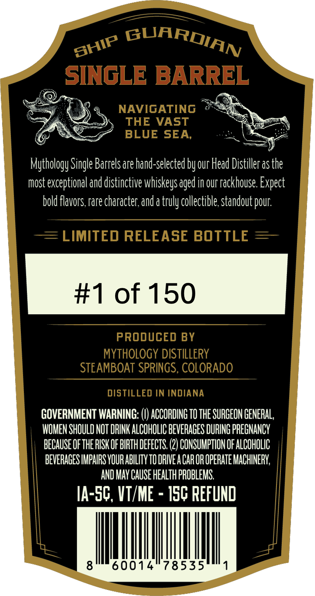
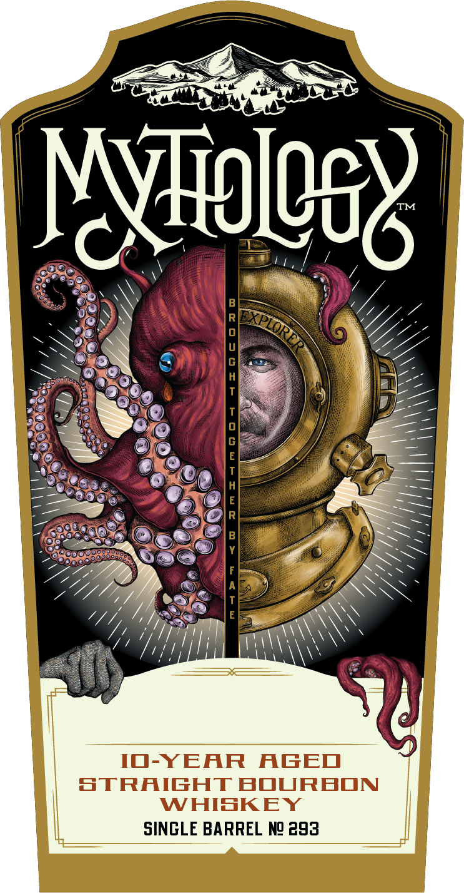

# TTB COLA Label Images - TTBID 26271001000854

**Brand Name:** MYTHOLOGY

**Issue Date:** 11/20/2026

**Origin Code:** 13

**Product Class/Type:** 101

**Source:** [TTB Public COLA Registry](https://ttbonline.gov/colasonline/viewColaDetails.do?action=publicFormDisplay&ttbid=26271001000854)

## Label Images

### Back Label

### Front Label

## Extracted Label Text

*Text extracted via OCR - may contain errors*

*1 image(s) excluded: text did not meet readability threshold*

### Back Label

SINGLE BARREL
NAVIGATING
THE VAST
BLUE
SEA;
Mythology Singte Barrels are hand-setected by our Head Distiller as the
most exceptional and distinctive whiskeys aged in our rackhouse. Expect
bold flavors rare character,anda truly collectible.standout pour:
LIMITED RELEASE BOTTLE
#1 of 150
PRODUCED BY
MYTHOLOGY DISTILLERY
STEAMBOAT SPRINGS, COLORADO
DISTILLED IN INDIANA
GOVERNMENT WARNING:
ACCORDING TO THE SURGEON GENERAL,
WOMEN SHOULD NOT DRINK ALCOHOLIC BEVERAGES DURING PREGNANCY
BECAusEofThERISK OF BIRTH DEFECTS, (2) CONSUMPTION OF ALCOHOLIC
BEVERACES IMPAIRS VOUR ABILITY TO DRIEA CAR OR OPERATEMACHINERV;
AND MAY CAUSE HEALTh PROBLEMS;
IA-SC, VT/ME
ISC REfund
8
60014
78535
GUARQIAN
SHIP
