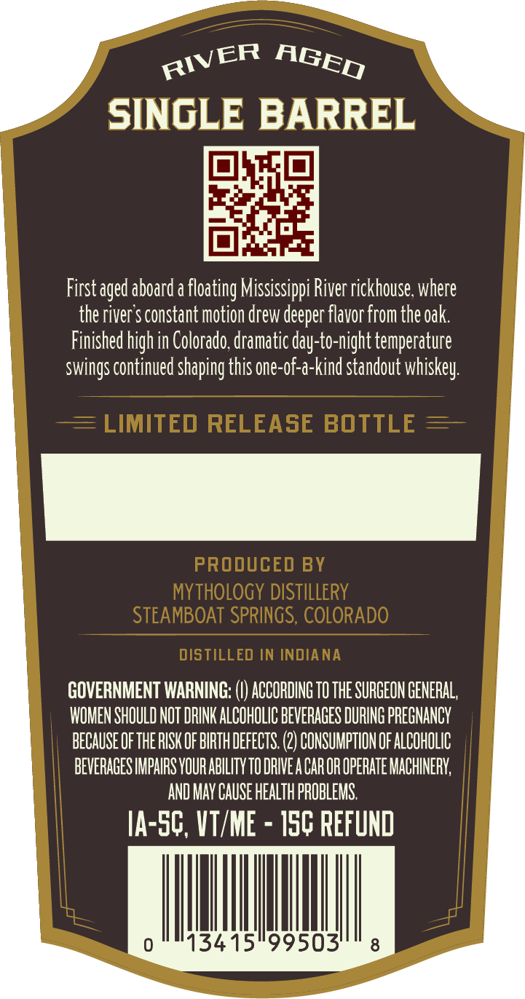
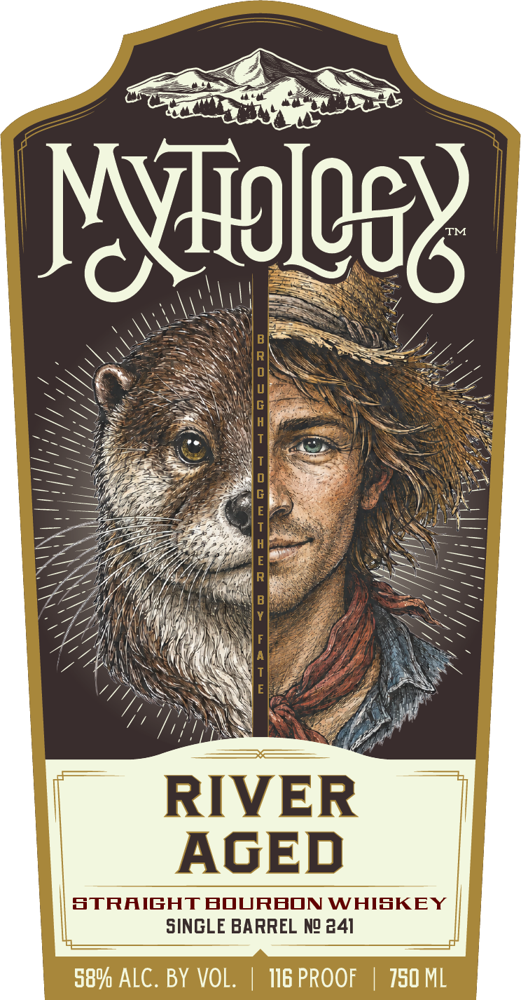

# TTB COLA Label Images - TTBID 26271001000855

**Brand Name:** MYTHOLOGY

**Issue Date:** 11/05/2026

**Origin Code:** 13

**Product Class/Type:** 101

**Source:** [TTB Public COLA Registry](https://ttbonline.gov/colasonline/viewColaDetails.do?action=publicFormDisplay&ttbid=26271001000855)

## Label Images

### Back Label

### Front Label

## Extracted Label Text

*Text extracted via OCR - may contain errors*

**Detected Proof:** 116

### Back Label

SINGLE BARREL
First aged aboard a floating Mississippi River rickhouse: where
the river $ constant motion drew deeper flavor from the oak:
Finished high in Colorado,dramatic day-to-night temperature
continued shaping this one-of-a-kind standout
LIMITEd RELEASE BOTTLE
PRODUCED BY
MYTHOLOGY DISTILLERY
STEAMBOAT SPRINGS, COLORADO
DISTILLED IN INDIANA
GOVERNMENT WARNING:
ACCORDING TO THE SURGEON GENERAL,
WOMEN SHOULD NOT DRINK ALCOHOLIC BEVERAGES DURING PREGNANCY
BECAUSE OFTHE RISK OF BIRTH DEFECTS: (2) CONSUMPTION OF ALCOHOLIC
BEVERAGES IMPAIRS VOUR ABILITV TO DRIVEA CAROR OPERATE MACHINERV;
AND MaY CAUSE HEALTh PROBLEMS.
IA-SC, Vt/Me
ISC pefund
0
13415"99503'
8
RIVER
AGED
whiskey:
swings (

### Front Label

CRT MRT DOO
Myo 06 .
— wf
SEL HY, PO We” ae . ==
Lippyp Wy 71 =
LEG i\ Na Wi aS. S >
“PANS SNARES || DAS
GY SENN Mis ee
STRAIGHT BOURBON WHISKEY
SINGLE BARREL No 241
58% ALC. BY VOL. | N&PROOF | 750 ML
