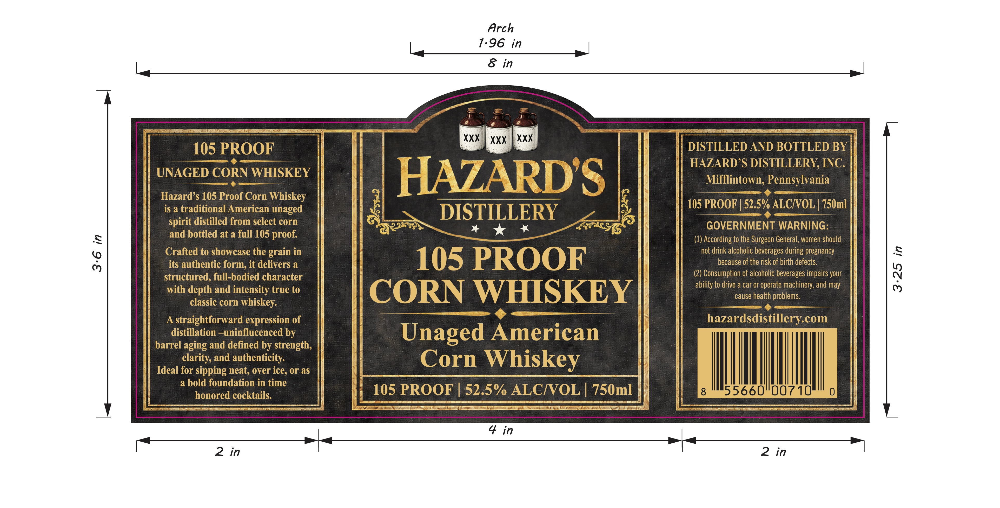

# TTB COLA Label Images - TTBID 26272001000169

**Brand Name:** HAZARD'S DISTILLERY, INC.

**Issue Date:** 10/08/2026

**Origin Code:** 39

**Product Class/Type:** 143

**Source:** [TTB Public COLA Registry](https://ttbonline.gov/colasonline/viewColaDetails.do?action=publicFormDisplay&ttbid=26272001000169)

## Label Images

### Label 1

## Extracted Label Text

*Text extracted via OCR - may contain errors*

**Detected Proof:** 105

### Label 1

Arch
7.96 in
8 in
XXX
XXX
XXX
105 PROOF
DISTILLED AND BOTTLED BY
HAZARDS DISTILLERY, INC:
UNAGED CORN WHISKEY
HAZARDS
Mifflintown; Pennsylvania
Hazard s 105 Proof Corn Whiskey
is a traditional American
unaged
DISTILLERY
105 PROOF | 52.5% ALCIOL | 750ml
distilled from select corn
GOVERNMENT WARNING:
and bottled at a full 105 proof:
(1) According to the Surgeon General, women should
{
Crafted to showcase the
in
not drink alcoholic beverages during pregnancy
its authentic form; it delivers a
105 PROOF
because of the risk of birth defects
structured, full-bodied character
(2) Consumption of alcoholic beverages impairs your
3
ability to drive a car or operate machinery; and may
with depth and intensity true to
CORN WHISKEY
cause health problems.
classic corn
whiskey:
A
straightforward expression of
hazardsdistillerycom
distillation ~uninflucenced by
Unaged American
barrel aging and defined by strength,
clarity; and authenticity:
Corn Whiskey
Ideal for sipping neat, over ice, or as
a bold foundation in time
honored cocktails:
105 PROOF
52.5% ALCIVOL
750ml
55660"00710
4 in
2 in
2
in
spirit
grain
