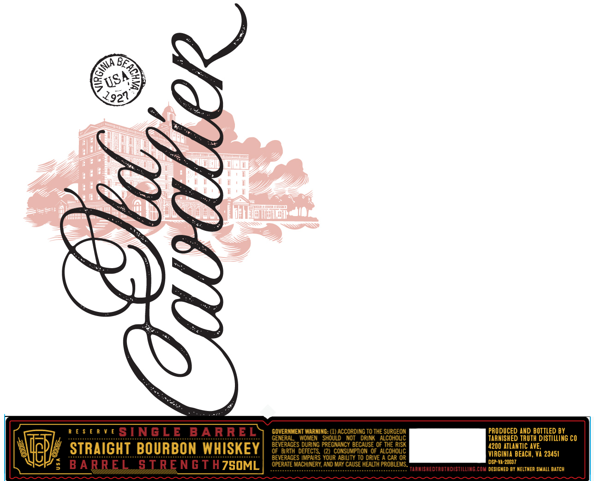
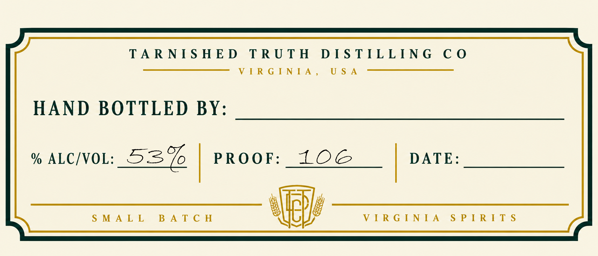
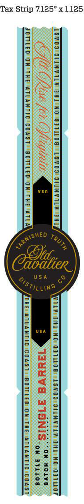

# TTB COLA Label Images - TTBID 26272001000363

**Brand Name:** OLD CAVALIER

**Issue Date:** 10/14/2026

**Origin Code:** 05

**Product Class/Type:** 101

**Source:** [TTB Public COLA Registry](https://ttbonline.gov/colasonline/viewColaDetails.do?action=publicFormDisplay&ttbid=26272001000363)

## Label Images

### Label 1

### Label 2

### Label 3

## Extracted Label Text

*Text extracted via OCR - may contain errors*

**Detected Proof:** 106

### Label 1

0S/
2921
4
0 [ $ ! R v [
SINGLE
B A R REL
GovERHMENT WarninG: (I)ACCORDING T0 THE SURGEOM
PRODUCED AND BOTTLED BY
GENERIL
HoveN
Should
NOT
DRINK   AlcohovC
TARNISHED TRUTH DISTILLING CO
STRAIGHT BOURBON WHISKEY
beveRAGES durng pregiumicy becaUsE 0f THE Rish
4200 ATLAntIc AVE,
0F brih defEcTS
(2) consuvpiion 0f AlcohouC
VIRGINIA BEACH, VA 23451
BEVERAGES Imphirs Your Abivty I0 ORIVE
CAR 0R
5
B A RREL
STrTngT H7G0ML
OPERAIE VacHINERY Aid May CavSE HEALH PROBLEMS
DSP-VA-20037
tianishedtautadistillimg Com deSIGNED BY NeltmeA SMALL BATCH
GEaC,
KGinA _

### Label 2

TARNISHED TRUTH DISTILLING CO
SS Re G-Ne A  —E—————
HAND BOTTLED BY:
% ALC/VOL: 53% | PROOF: 10G | DATE:
uuu eeoe ce aeame | Seger rere cera
SMALL BATCH WoW VIRGINIA SPIRITS

### Label 3

Tax Strip 7.125” x 1.125

2

1SVOD DIINVILY nau NO GFT 08) Tsv00 BL HL

cS. Ge CG Mise [Ot Ce gilt

Z0TPLED ON THE ATUANTIC: CONST! BOTTLED ON THE ATLA os

7

Le

TLV GH L NO GITMOG | ASVOOOIMNVILV AHA NO GIILLOe
‘ csajve ON HOlve
: auuVE A 1SNIS.,, eke

HEVATLANTIC COAST BOTTLED ONO THE ATLANTIC COAST

Pn

Lil

cHED

NG:
WL

{
\

).

C

[e
/
v,
