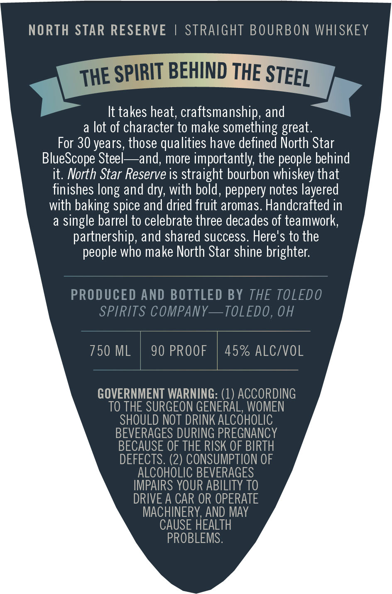
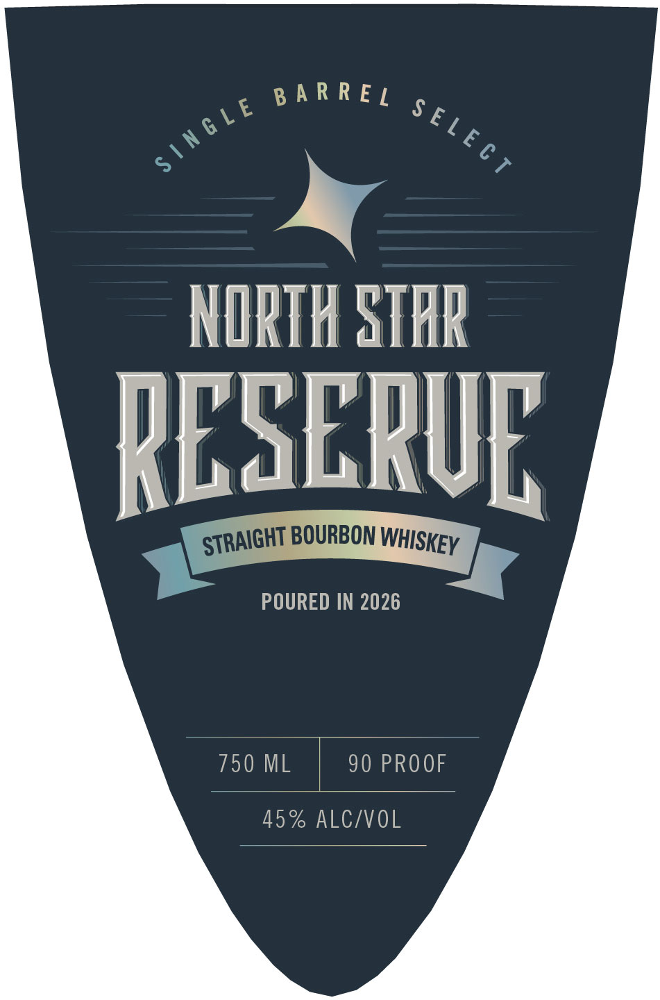

# TTB COLA Label Images - TTBID 26272001000379

**Brand Name:** NORTH STAR RESERVE

**Issue Date:** 10/20/2026

**Origin Code:** 09

**Product Class/Type:** 101

**Source:** [TTB Public COLA Registry](https://ttbonline.gov/colasonline/viewColaDetails.do?action=publicFormDisplay&ttbid=26272001000379)

## Label Images

### Back Label

### Front Label

## Extracted Label Text

*Text extracted via OCR - may contain errors*

**Detected Proof:** 90
**Detected Age:** 30 Years

### Back Label

NORTH STAR RESERVE
STRAIGHT BOURBON WHISKEY
SPIRIT BEHIND THE
It takes heat; craftsmanship, and
a lot of character to make
something
For 30 years, those qualities have defined North Star
BlueScope Steel
and; more importantly; the people behind
it. North Star Reserve is straight bourbon whiskey that
finishes
and dry, with bold, peppery notes layered
with baking spice and dried fruit aromas. Handcrafted in
a
single barrel to celebrate three decades of teamwork,
partnership, and shared success: Here's to the
people who make North Star shine brighter:
PRODUCED AND BOTTLED BY THE TOLEDO
SPIRITS COMPANY
TOLEDO, OH
750 ML
90 PROOF
45% ALC/VOL
GOVERNMENT WARNING: (1) ACCORDING
TO THE SURGEON GENERAL, WOMEN
SHOULD NOT DRINK ALCOHOLIC
BEVERAGES DURING PREGNANCY
BECAUSE OF THE RISK OF BIRTH
DEFECTS. (2) CONSUMPTION OF
ALCOHOLIC BEVERAGES
IMPAIRS YOUR ABILITY TO
DRIVE A CAR OR OPERATE
MACHINERY,AND MAY
CAUSE HEALTH
PROBLEMS.
STEEL
THE
great.
long

### Front Label

B
t
.® 2

NORTH StHR

babkl

STRAIGHT BOURBON WHisyey

POURED IN 2026

750 ML | 90 PROOF

45% ALC/VOL
