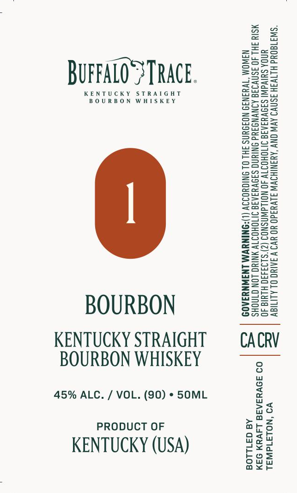

# TTB COLA Label Images - TTBID 26273001000039

**Brand Name:** BUFFALO TRACE

**Issue Date:** 10/09/2026

**Origin Code:** 01

**Product Class/Type:** 101

**Source:** [TTB Public COLA Registry](https://ttbonline.gov/colasonline/viewColaDetails.do?action=publicFormDisplay&ttbid=26273001000039)

## Label Images

### Label 1

## Extracted Label Text

*Text extracted via OCR - may contain errors*

**Detected Proof:** 90

### Label 1

=soa

i

ZzEaeo

Saree

BUFFALO} TRACE.

=Sauw

==

Boe

KENTUCKY STRAIGHT

BOURBON WHISKEY

eoS

Hiei

nD

2Zeac

SSo=

BOWS

BSGz

Ssee>

Sow

Saag

enS=

wos

==eoz

ASC=

Ss

FSsc2

-Sre

Sa

e625

oosz

ee

S=25=

Eeug

Sots

SSset

Suzy

sos

oS

=aG

ooo

Sa55

S2a

SSce

Zsso

pues

s=R=

e205

E=eo=

S2eu

=Ssco

Geos

Sove

Boze

=e

S2ua

Ssal

wsSee

BOURBON

Ons

KENTUCKY STRAIGHT

CACRV

BOURBON WHISKEY

45% ALC. / VOL. (90) * SOML

no

Sa

a

PRODUCT OF

odah

aro

KENTUCKY (USA)

e<a

dew

ouw

bos

axe
