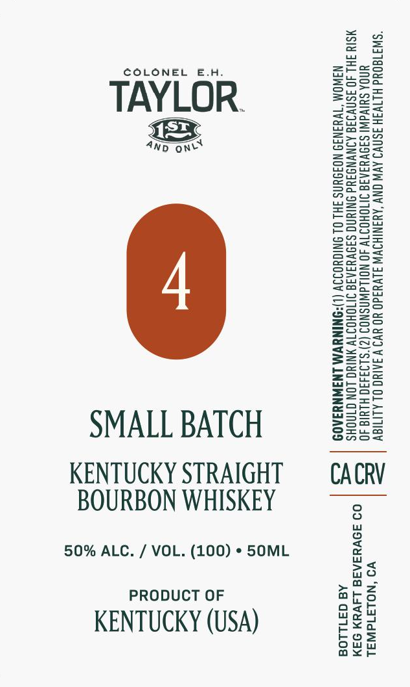

# TTB COLA Label Images - TTBID 26273001000042

**Brand Name:** COLONEL E.H. TAYLOR

**Issue Date:** 10/09/2026

**Origin Code:** 01

**Product Class/Type:** 101

**Source:** [TTB Public COLA Registry](https://ttbonline.gov/colasonline/viewColaDetails.do?action=publicFormDisplay&ttbid=26273001000042)

## Label Images

### Label 1

## Extracted Label Text

*Text extracted via OCR - may contain errors*

**Detected Proof:** 100

### Label 1

COLONEL E.H.

Sse

aT

ZzEaeo

Feer

Sun=

TAYLOR.

=Sau

p2ax

Bok

eeu

ecnaS=

4p one

BOWS

S>28

So=

BSeo=

S2e>

2Zeac

Seow

S209

enS>

ws

ASC=

Sz

o>ow

Eero

==o>

eG=a5

ons=

2as2

ee

S=se

Eeug

Sorts

SScset

Snzu

sesh

eS

=ag oe

ooo

Sa5S5

S2a

zoo

Zsso

SSae

S=G=

&@=a05

E=eco=

S2eu

Geos

Sore

zmoe>

Z==

=Ssco

Sona

a

see

SMALL BATCH

Ons

S2ua

KENTUCKY STRAIGHT

CACRV

BOURBON WHISKEY

50% ALC. / VOL. (100) * 50ML

no

>a

PRODUCT OF

oath

ars

Wo Wy

KENTUCKY (USA)

ou

bos

e¥o

ax<r
