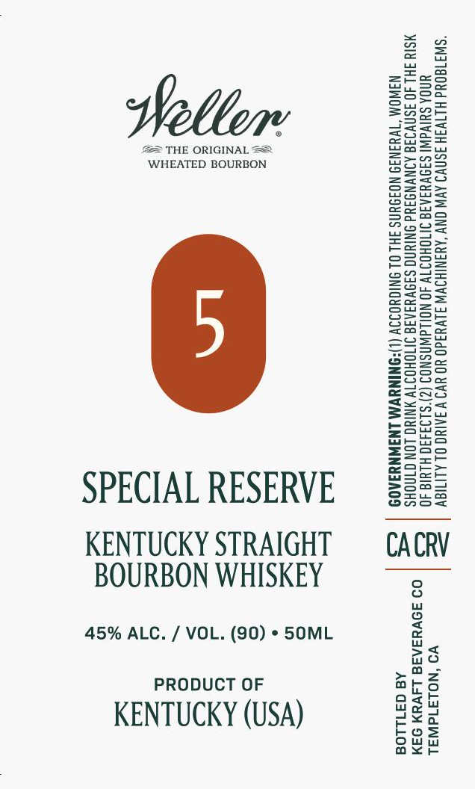

# TTB COLA Label Images - TTBID 26273001000043

**Brand Name:** WELLER

**Issue Date:** 10/08/2026

**Origin Code:** 01

**Product Class/Type:** 101

**Source:** [TTB Public COLA Registry](https://ttbonline.gov/colasonline/viewColaDetails.do?action=publicFormDisplay&ttbid=26273001000043)

## Label Images

### Label 1

## Extracted Label Text

*Text extracted via OCR - may contain errors*

**Detected Proof:** 90

### Label 1

aT

ZzEaeo

Feer

Sun=

Sse

Weller

=Sau

p2ax

=

25

== THE ORIGINAL ==

eeu

eaS=

WHEATED BOURBON

BOWS

Lasser

So=

BSeo=

S2e>

2Zeac

Seow

S209

enS>

ws

ASC=

Sz

o>ow

Eero

==o>

eG=a5

ons=

2as2

ee

S=se

Eeug

Sorts

SScset

Snzu

sesh

eS

=ag oe

ooo

Sa5S5

S2a

Za-=

Zsso

SSae

S=G=

&@=a05

E=eco=

S2eu

Geos

Sore

zmoe>

=Ssco

=e—

Sona

SSs5

see

SPECIAL RESERVE

Ons

S2ua

KENTUCKY STRAIGHT

CACRV

BOURBON WHISKEY

45% ALC. / VOL. (90) * 50ML

>a

no

PRODUCT OF

oath

ars

Wo Wy

KENTUCKY (USA)

ou

bos

e¥o

ax<r
