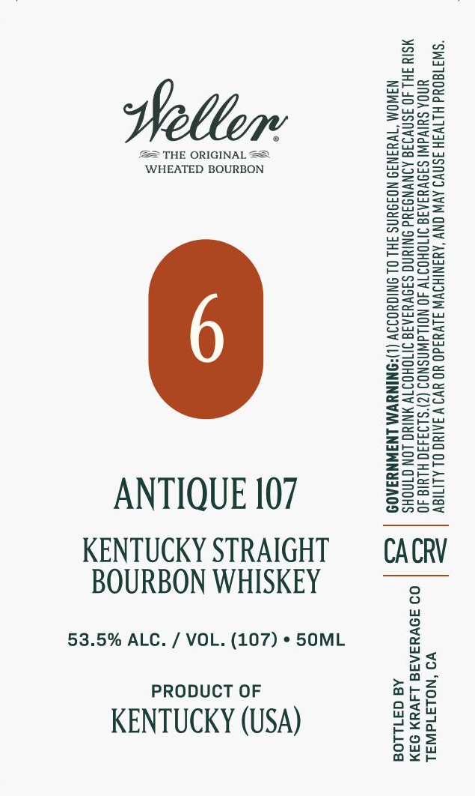

# TTB COLA Label Images - TTBID 26273001000044

**Brand Name:** WELLER

**Issue Date:** 10/09/2026

**Origin Code:** 01

**Product Class/Type:** 101

**Source:** [TTB Public COLA Registry](https://ttbonline.gov/colasonline/viewColaDetails.do?action=publicFormDisplay&ttbid=26273001000044)

## Label Images

### Label 1

## Extracted Label Text

*Text extracted via OCR - may contain errors*

**Detected Proof:** 107

### Label 1

“SW3180Ud HLTV3H 3SNVI AVW ONY ‘AYANIHSVW J1VY3d0 YO YV9 VAAINO OL ALITIOV
UNOA SUIVAWI SINVYIAIS INTOHOIT 40 NOWdWASNOS (Z)'S193490 HLYIG 40
MSIY FHL JO ISNVIIG AINVNGIYd ONIUNG SANVYIAIG INOHOITV YNIYG LON GINOHS
NAWOM “TWYIN3I9 NOIDUNS FHL OL INIGYOIIV (L)ONINYVM LNINNYIAOD

VO ‘NOLAId WAL
09 39VHSARE L4VYN 94M
Aa 371108

CACRV

THE ORIGINAL 2
WHEATED BOURBON

BOURBON WHISKEY
53.5% ALC. / VOL. (107) » SOML
PRODUCT OF
KENTUCKY (USA)

ANTIQUE 107
KENTUCKY STRAIGHT
