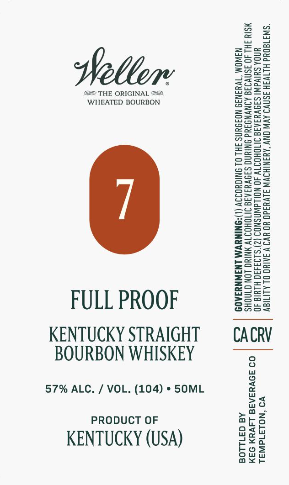

# TTB COLA Label Images - TTBID 26273001000045

**Brand Name:** WELLER

**Issue Date:** 10/08/2026

**Origin Code:** 01

**Product Class/Type:** 101

**Source:** [TTB Public COLA Registry](https://ttbonline.gov/colasonline/viewColaDetails.do?action=publicFormDisplay&ttbid=26273001000045)

## Label Images

### Label 1

## Extracted Label Text

*Text extracted via OCR - may contain errors*

**Detected Proof:** 114

### Label 1

“SW3180Ud HLTV3H 3SNVI AVW ONY ‘AYANIHSWW JLVY3d0 YO YV9 VAAING OL ALITIOV
UNOA SUIVAW! SINVYIAIS INTOHOIT 40 NOLAWASNOS (2)'S193490 HLYIG 40
MSIY FHL JO ISNVIIG AINVNGIYd ONIUNG SA9NVYIAIG INOHOITV NIYG LON GINOHS
N3WOM “TWYIN3I9 NOIDUNS FHL OL INIGYOIIV (L)ONINYWM LNINNYIAOD

VO ‘NOLAId WAL
09 39VHSAR8 L4VYN 94M
Aa 371108

CACRV

THE ORIGINAL 2
WHEATED BOURBON

BOURBON WHISKEY
57% ALC. / VOL. (104) » 5OML
PRODUCT OF
KENTUCKY (USA)

FULL PROOF
KENTUCKY STRAIGHT
