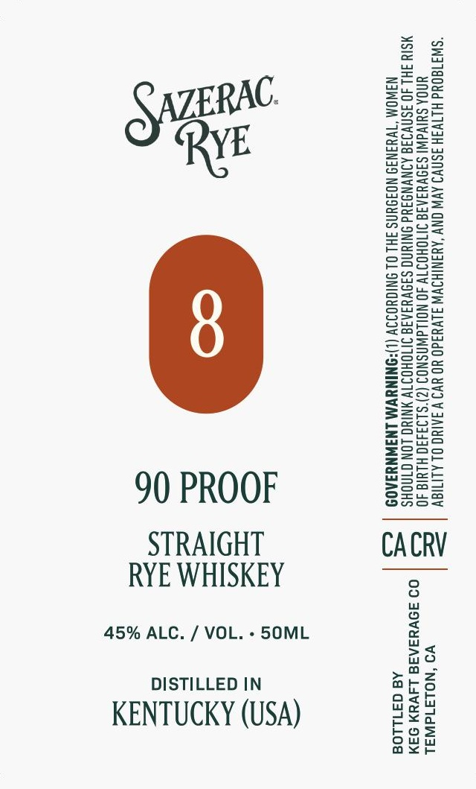

# TTB COLA Label Images - TTBID 26273001000046

**Brand Name:** SAZERAC

**Issue Date:** 10/19/2026

**Origin Code:** 01

**Product Class/Type:** 102

**Source:** [TTB Public COLA Registry](https://ttbonline.gov/colasonline/viewColaDetails.do?action=publicFormDisplay&ttbid=26273001000046)

## Label Images

### Label 1

## Extracted Label Text

*Text extracted via OCR - may contain errors*

**Detected Proof:** 90

### Label 1

“SW310Ud HLTV3H ISNV9 AV ONY ‘ANANIHOVW J1V49d0 YO V9 V 3AING OL ALITIGV
UNOA SUIVAW! SI9NVYIAIS INTIOHOIT 40 NOWAWASNOS (Z)'S193490 HLYIa 40
MSIY FHL JO ISNVIIG AINVNGIYd ONIYNG SINVYIAIG INOHOITV NIYG LON GINOHS
NAWOM “TVY3NI9 NOIDUNS FHL OL INIGYOIIV (L)*ONINYVM LNINNYIAOD

90 PROOF

ae
Be

CACRV

STRAIGHT
RYE WHISKEY

45% ALC. / VOL. - 5S0ML

VO ‘NOLAId WAL

09 39VYSAR8 L4VYN 94M

A@ G31LLO8

DISTILLED IN
KENTUCKY (USA)
