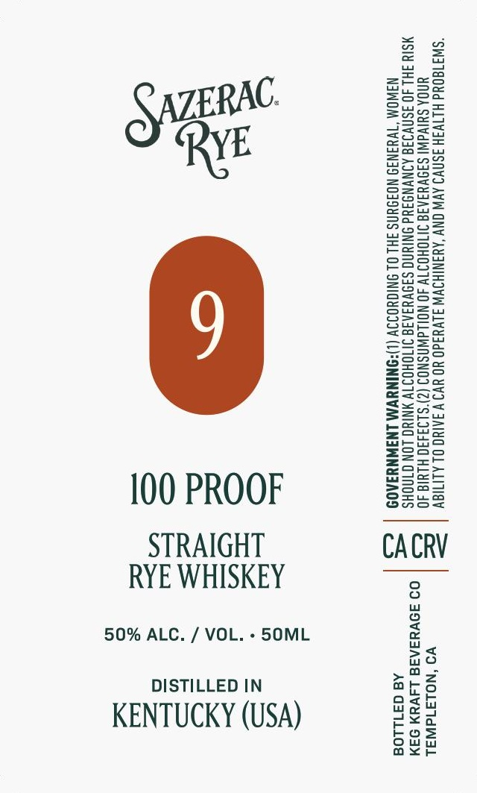

# TTB COLA Label Images - TTBID 26273001000047

**Brand Name:** SAZERAC

**Issue Date:** 10/14/2026

**Origin Code:** 01

**Product Class/Type:** 102

**Source:** [TTB Public COLA Registry](https://ttbonline.gov/colasonline/viewColaDetails.do?action=publicFormDisplay&ttbid=26273001000047)

## Label Images

### Label 1

## Extracted Label Text

*Text extracted via OCR - may contain errors*

**Detected Proof:** 100

### Label 1

“SW3180Ud HLTV3H ISNV9 AV ONY ‘AYANIHOVW J1VU3d0 YO YV9 V IAINO OL ALIIGY
UNOA SUIVAW! SI9VYIAIS INTOHOIT 40 NOWAWASNOS (2)'S193490 HLUIG 40
MSIY FHL JO ISNVIIG AINVNGIYd ONIUNG SANVYIAIG INOHOITV ANIYG LON GINOHS
NAWOM “TVYINI9 NOIDUNS IHL OL SNIGHOIIV (L)!ONINYVM LNINNYIA0D

100 PROOF

ae
Se

CACRV

STRAIGHT
RYE WHISKEY

50% ALC. / VOL. - 50ML

VO ‘NOLAId WAL

09 39VHSAR8 L4VeN 94M

Aa 371108

DISTILLED IN
KENTUCKY (USA)
