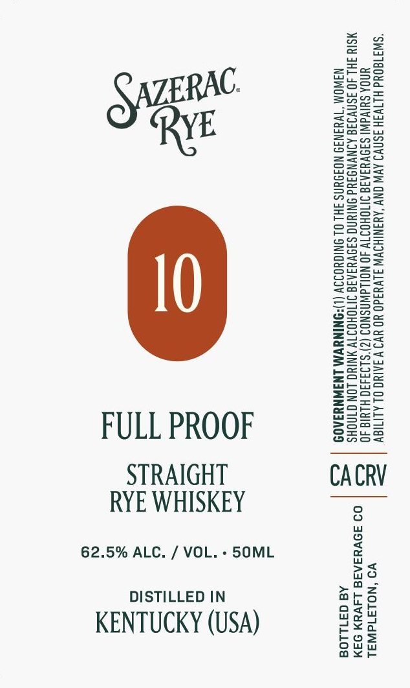

# TTB COLA Label Images - TTBID 26273001000048

**Brand Name:** SAZERAC

**Issue Date:** 10/15/2026

**Origin Code:** 01

**Product Class/Type:** 102

**Source:** [TTB Public COLA Registry](https://ttbonline.gov/colasonline/viewColaDetails.do?action=publicFormDisplay&ttbid=26273001000048)

## Label Images

### Label 1

## Extracted Label Text

*Text extracted via OCR - may contain errors*

**Detected Proof:** 125

### Label 1

=zEaeo

Ssea

SPSs2

RAC

Save

Sun

ee

=Seu

=a

oF

eos

eo Su

VE

Z2e2c

Hows

So028

Se=

BSeo=

S2e>

Seow

Sfaa

ens =

wes

ASCE

Sz

Esra

==o>

sa

ons=

2ase

ee

S=s

Eeug

ea=asy

SS=cset

oenzu

=ag oe

Sones

SSS55

sesh

SS

Sa

Zoso

eltz=

SoSa

&@=a05

Za-—=

S2eu

S=G=

Geos

Sous

E=eco=

z=

=Ssco

a

moOe>

FULL PROOF

CnS=

Slfu5

Sout

STRAIGHT

CACRV

RYE WHISKEY

62.5% ALC. / VOL. - 50ML

no

>a

DISTILLED IN

oath

ars

KENTUCKY (USA)

ceo

ae Ww

ou

FOS

ax<r
