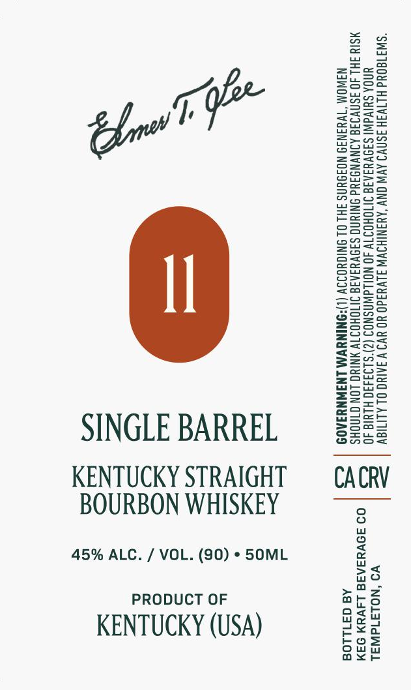

# TTB COLA Label Images - TTBID 26273001000050

**Brand Name:** ELMER T. LEE

**Issue Date:** 10/08/2026

**Origin Code:** 01

**Product Class/Type:** 101

**Source:** [TTB Public COLA Registry](https://ttbonline.gov/colasonline/viewColaDetails.do?action=publicFormDisplay&ttbid=26273001000050)

## Label Images

### Label 1

## Extracted Label Text

*Text extracted via OCR - may contain errors*

**Detected Proof:** 90

### Label 1

“SW3180Ud HLTV3H 3SNVI AVW ONY ‘AYANIHSWW JLVY3d0 YO YV9 VAAING OL ALITIOV
UNOA SUIVdWI SIDVYIAIS IITOHOIT 40 N (2)'$193430 HLUI€ 40
MSIY IHL JO ISNVIIG AINVNGIYd ONIUNG SA9VYS J1V NIG LON GINOHS
NAWOM “TVYINI9 NOIDUNS FHL OL ONIGYO ‘ONINUVM LNIWNYIA0D

VO ‘NOLAId WAL
09 39VHSAR8 L4VYN 94M
Aa 371108

CACRV

XQ
*

SINGLE BARREL
KENTUCKY STRAIGHT
45% ALC. / VOL. (90) * SOML

PRODUCT OF
KENTUCKY (USA)

BOURBON WHISKEY
