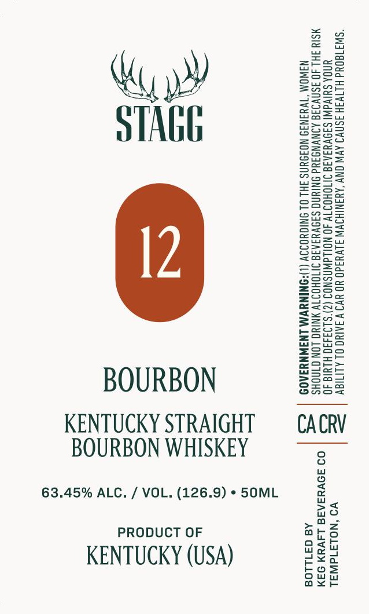

# TTB COLA Label Images - TTBID 26273001000051

**Brand Name:** STAGG

**Issue Date:** 10/08/2026

**Origin Code:** 01

**Product Class/Type:** 101

**Source:** [TTB Public COLA Registry](https://ttbonline.gov/colasonline/viewColaDetails.do?action=publicFormDisplay&ttbid=26273001000051)

## Label Images

### Label 1

## Extracted Label Text

*Text extracted via OCR - may contain errors*

**Detected Proof:** 126.9

### Label 1

ZzEaeo

Ssea

eT

Save

Beet

wi

=Sauw

==5

eu

eas=

nD

STAGE

S2So=

BOOS

Zac

BSaz

Sae>

Sow

Siaa

enS>

wos

ASC=

S=

o>ow

-Sze

==eoz

oos=

2as2

ee

Ss=2s5=

2eug

ea=as

SSset

Suzy

=a oe

Sorts

ooo

Sa55

sos

SS

Zsso

S2a

e205

SSce

pues

S2eu

s=R=

Geos

Sous

E=eo=

=Sco

ee

a

Boze

See

BOURBON

Ons

Sf2ua

Ssal

KENTUCKY STRAIGHT

CACRV

BOURBON WHISKEY

63.45% ALC. / VOL. (126.9) * 50ML

no

Sa

a

PRODUCT OF

odah

aro

KENTUCKY (USA)

e¥a

ge w

ou

os

axe
