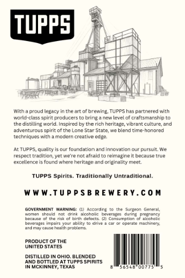
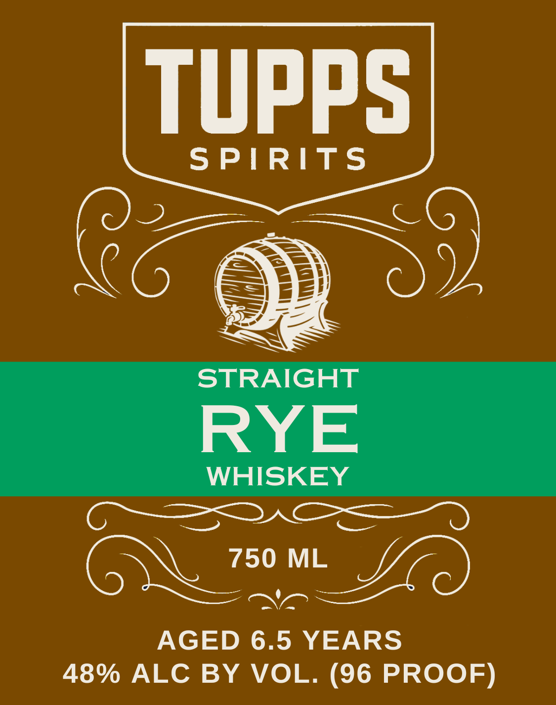

# TTB COLA Label Images - TTBID 26273001000392

**Brand Name:** TUPPS SPIRITS

**Issue Date:** 10/16/2026

**Origin Code:** 44

**Product Class/Type:** 102

**Source:** [TTB Public COLA Registry](https://ttbonline.gov/colasonline/viewColaDetails.do?action=publicFormDisplay&ttbid=26273001000392)

## Label Images

### Back Label

### Label 1

## Extracted Label Text

*Text extracted via OCR - may contain errors*

**Detected Proof:** 96
**Detected Age:** 6.5 Years

### Back Label

TupPS)
Witch ,
droud
egacy
the a
rexing
TuppS hae
ranered
vith
worlo-cldsy spint producers
bringa nevs leve
crattsman nip
IHc distiln wcrd
Inspircd by thc nch heritage, vibrant culture; and
acventrous
spirit of the Lone Star State vie blena time-honoreo
Tocnniaucs  rn
moder Cicativt
cdge;
At TUPPS
quallty
Tolncanonanoinnovancn Om
Duisuit
Fespect trddition
noL airaio
rejmapine
because true
exceilence
Jound Winete heritane and
originality meet
TUPPS Spirits_
Traditionally Untraditional.
W WW.TuP P s B RE WE RY.c0 M
GOVERNMENT
WaknING:
AcCordina
qumed
Gen eal
Komen
chomt
GTg
Aconmc
covcrac=
Jum7e
prorninc
DCCJUSC
Eimth catcr
Consutotidn
EDnauc
bCvC ICC
Impaic: Your icuity
apcratc Micher,
mndm1/causc ncalth problTe
PRODUCT OF THE
UNITED STATES
DISTILLED IN OhiO. BLENDED
AND BOTTLED AT Tupps spiRITS
IN MCKINNEY, TEXAS

### Label 1

tupPS
SPIRITS
STRAIGHT
RYE
WHISKEY
TC
750 ML
AGED 6.5 YEARS
48% ALC BY
VOL. (96 PROOF)
