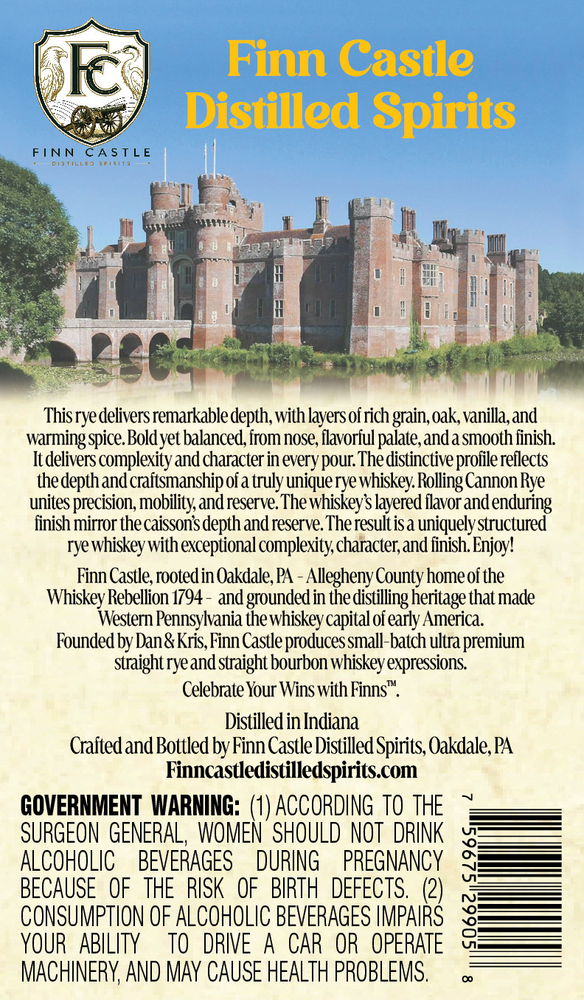
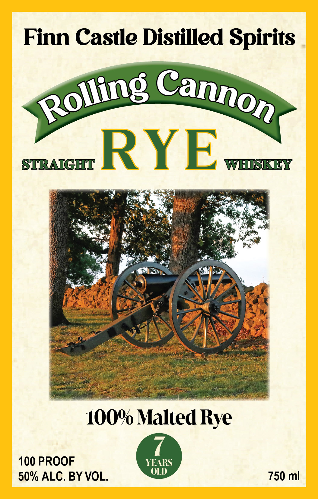

# TTB COLA Label Images - TTBID 26273001000929

**Brand Name:** FINN CASTLE DISTILLED SPIRITS

**Fanciful Name:** ROLLING CANNON RYE

**Issue Date:** 10/14/2026

**Origin Code:** 39

**Product Class/Type:** 102

**Source:** [TTB Public COLA Registry](https://ttbonline.gov/colasonline/viewColaDetails.do?action=publicFormDisplay&ttbid=26273001000929)

## Label Images

### Back Label

### Front Label

## Extracted Label Text

*Text extracted via OCR - may contain errors*

**Detected Proof:** 100

### Back Label

Finn Castle
Distilled Spirits

This rye delivers remarkable depth, with layers of rich grain, oak, vanilla, and
warming spice. Bold yet balanced, from nose, flavorful palate, and a smooth finish.
It delivers complexity and character in every pour. The distinctive profile reflects
the depth and craftsmanship of a truly unique rye whiskey, Rolling Cannon Rye
unites precision, mobility, and reserve. The whiskey’s layered flavor and enduring
finish mirror the caisson’s depth and reserve. The result is a uniquely structured
rye whiskey with exceptional complexity, character, and finish. Enjoy!

Finn Castle, rooted in Oakdale, PA - Allegheny County home of the
Whiskey Rebellion 1794 - and grounded in the distilling heritage that made
Western Pennsylvania the whiskey capital of early America.

Founded by Dan & Kris, Finn Castle produces small-batch ultra premium
straight rye and straight bourbon whiskey expressions.

Celebrate Your Wins with Finns™.

Distilled in Indiana
Crafted and Bottled by Finn Castle Distilled Spirits, Oakdale, PA
Finncastledistilledspirits.com

GOVERNMENT WARNING: (1) ACCORDING TO THE ~
SURGEON GENERAL, WOMEN SHOULD NOT DRINK
ALCOHOLIC BEVERAGES DURING PREGNANCY
BECAUSE OF THE RISK OF BIRTH DEFECTS. (2)
CONSUMPTION OF ALCOHOLIC BEVERAGES IMPAIRS
YOUR ABILITY TO DRIVE A CAR OR OPERATE
MACHINERY, AND MAY CAUSE HEALTH PROBLEMS.

S0662)S296S

### Front Label

Finn Castle Distilled Spirits
STRAIGHT
RYE
WSKY
10O% Malted Rye
100 PROOF
YEARS
(LD
50% ALC. BY VOL
750 ml
Cannon
Rolling_
