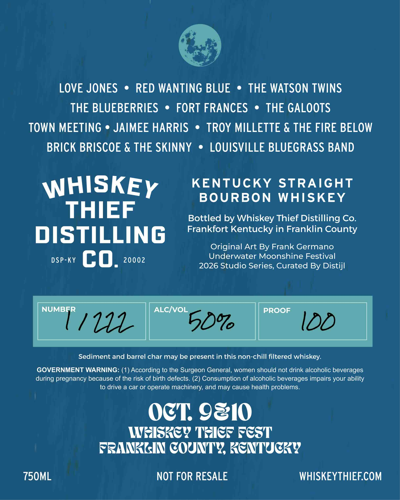
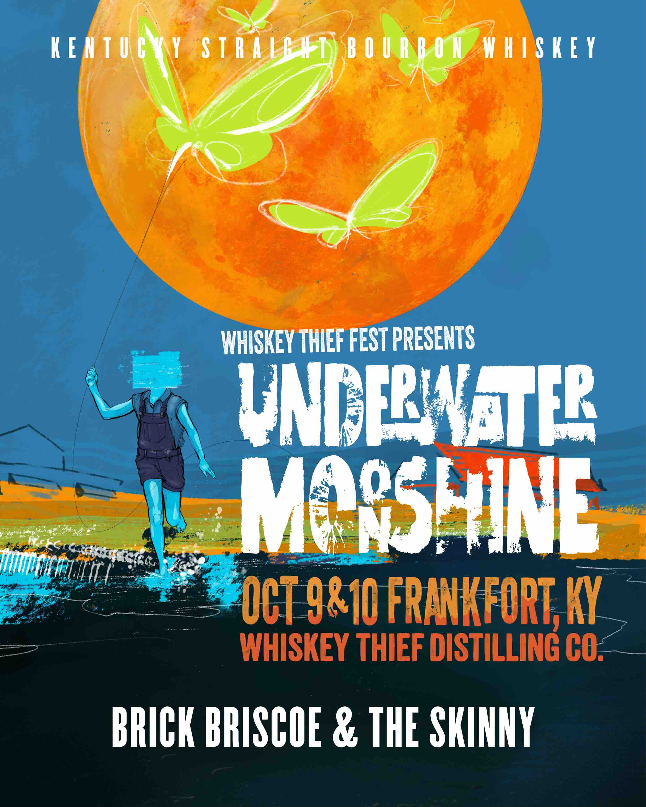

# TTB COLA Label Images - TTBID 26274001000063

**Brand Name:** WHISKEY THIEF DISTILLING CO.

**Fanciful Name:** UNDERWATER MOONSHINE

**Issue Date:** 11/23/2026

**Origin Code:** 22

**Product Class/Type:** 101

**Source:** [TTB Public COLA Registry](https://ttbonline.gov/colasonline/viewColaDetails.do?action=publicFormDisplay&ttbid=26274001000063)

## Label Images

### Back Label

### Front Label

## Extracted Label Text

*Text extracted via OCR - may contain errors*

### Back Label

LOVE JONES
RED WANTING BLUE
THE WATSON TWINS
THE BLUEBERRIES
FORT FRANCES
THE GALOOTS
TOWN MEETING
JAIMEE HARRIS
TROY MILLETTE & THE FIRE BELOW
BRICK BRISCOE & THE SKINNY
LOUISVILLE BLUEGRASS BAND
WHISKEY
KENTUCKY
STRAIGHT
BOURBON
WHISKEY
THIEF
Bottled by Whiskey Thief Distilling Co.
Frankfort Kentucky in Franklin County
DISTILLING
Original Art By Frank Germano
DSP-KY
co.
20002
Underwater Moonshine Festival
2026 Studio Series, Curated By Distijl
NUMBFR
ALCIvOL
PROOF
11
50%6
IDD
Sediment and barrel char may be present in this non-chill filtered whiskey:
GOVERNMENT WARNING: (1) According to the Surgeon General, women should not drink alcoholic beverages
pregnancy because of the risk of birth defects. (2) Consumption of alcoholic beverages impairs your ability
to drive a car or operate machinery; and may cause health problems:
OCT 9810
WKISRCY THICF FCST
FranRkIN COUNTY, RCNTUCRY
750ML
NOT FOR RESALE
WHISKEYTHIEFCOM
during

### Front Label

KEXIUCY
STRAIAT
B 0 U R b 0 M
V hIS KE
WHISKEY THIEF FEST PRESENTS
VNDFR
JI[R

N)
Ne
0cF9810 FRANKFORT,KV
WHISKEY THIEF DISTILLING CO
BRICK BRISCOE & THE SKINNY
