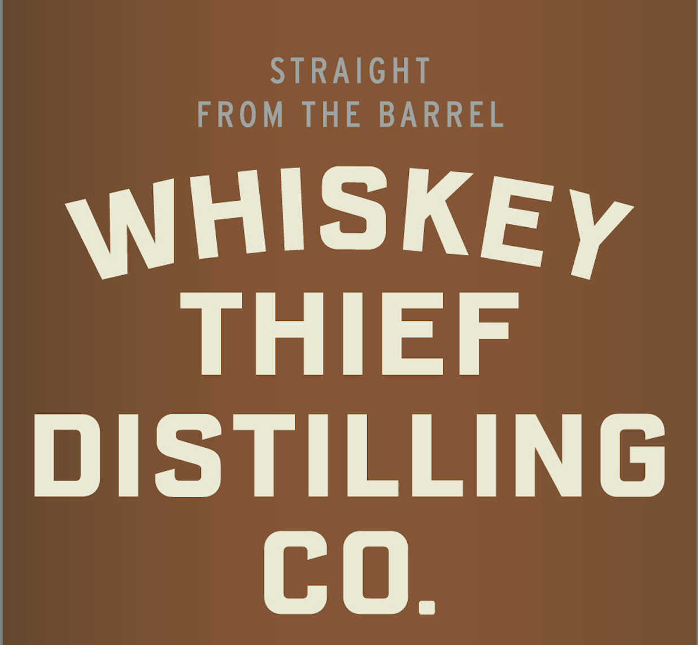
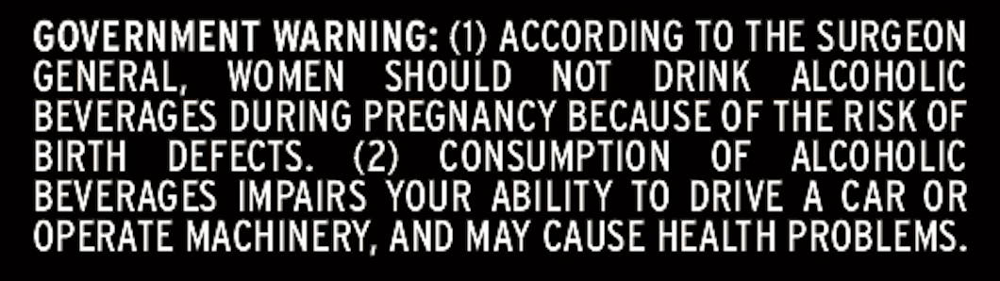
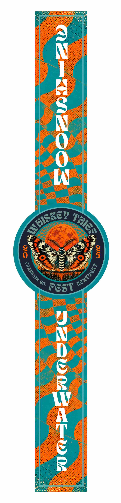

# TTB COLA Label Images - TTBID 26274001000068

**Brand Name:** WHISKEY THIEF DISTILLING CO.

**Fanciful Name:** UNDERWATER MOONSHINE - RYE

**Issue Date:** 11/23/2026

**Origin Code:** 22

**Product Class/Type:** 102

**Source:** [TTB Public COLA Registry](https://ttbonline.gov/colasonline/viewColaDetails.do?action=publicFormDisplay&ttbid=26274001000068)

## Label Images

### Label 1

### Label 2

### Label 3

### Label 4

## Extracted Label Text

*Text extracted via OCR - may contain errors*

*1 image(s) excluded: text did not meet readability threshold*

### Label 1

STRAIGHT
FROM
THE
BARREL
WHISKEY
THIEF
DISTILLING
co.

### Label 2

GOVERNMENT WARNING: (1) ACCORDING TO THE SURGEON

GENERAL, WOMEN SHOULD NOT DRINK ALCOHOLIC

BEVERAGES DURING PREGNANCY BECAUSE OF THE RISK OF

BIRTH DEFECTS.

(2) CONSUMPTION OF ALCOHOLIC

BEVERAGES IMPAIRS YOUR ABILITY TO DRIVE A CAR OR

OPERATE MACHINERY, AND MAY CAUSE HEALTH PROBLEMS.

### Label 4

ALcivo
PROOF
THIEVED
AGE IN YEARS
BBL
BOTTLED
BY WHISKEY THIEF DISTILLING CO .
FRANKFORT
KENTUCKY
5u%
44pS 11-48
IN FRANKLIN COUNTY
8
8
MASHBILL
750ML
KENTUCKY STRAIGHT
ndcrWATCR
RYE WHISKEY
Mooiszinc
ADR_I IDC
Co,
FCST
HiSRc)
THCA
1
1
