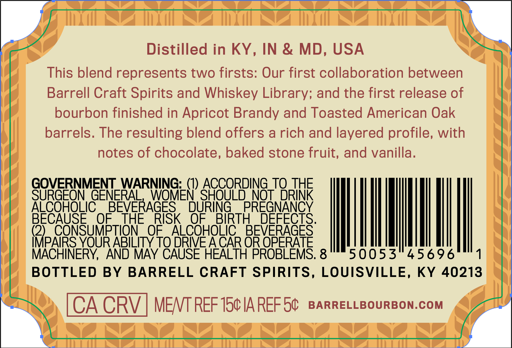
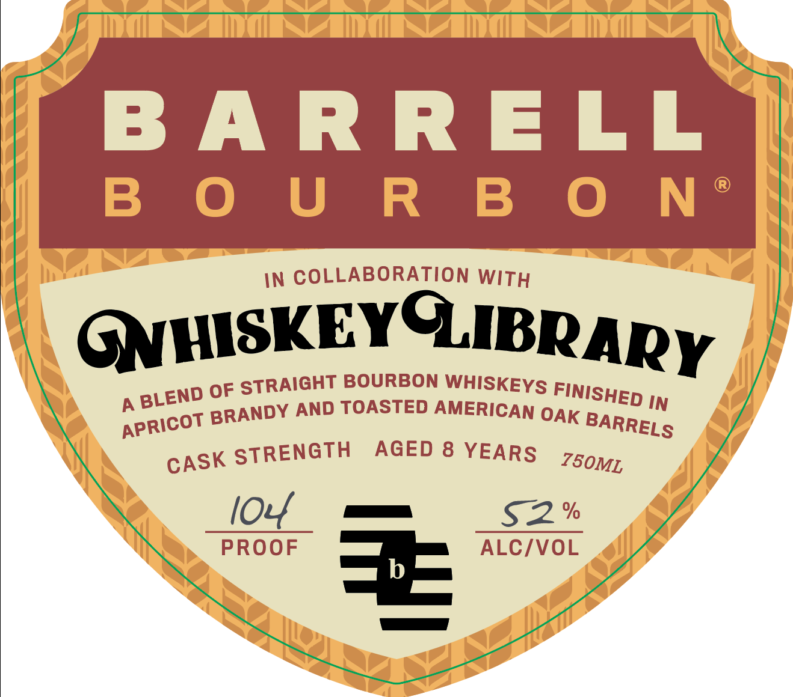
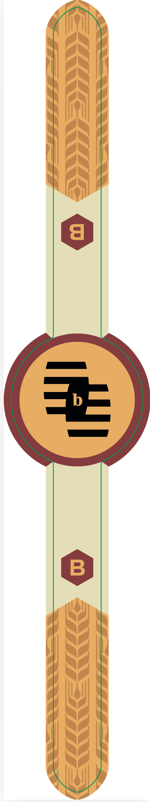

# TTB COLA Label Images - TTBID 26274001000271

**Brand Name:** BARRELL BOURBON

**Issue Date:** 10/15/2026

**Origin Code:** 22

**Product Class/Type:** 121

**Source:** [TTB Public COLA Registry](https://ttbonline.gov/colasonline/viewColaDetails.do?action=publicFormDisplay&ttbid=26274001000271)

## Label Images

### Back Label

### Front Label

### Label 2

## Extracted Label Text

*Text extracted via OCR - may contain errors*

*1 image(s) excluded: text did not meet readability threshold*

**Detected Proof:** 104
**Detected Age:** 8 Years

### Back Label

Distilled in KY,
IN & MD, USA
This blend represents two firsts: Our first collaboration between
Barrell Craft Spirits and Whiskey Library; and the first release of
bourbon finished in Apricot Brandy and Toasted American Oak
barrels. The resulting blend offers a rich and layered profile, with
notes of chocolate, baked stone fruit, and vanilla.
GOVERNMENT_WARNING:_(I) ACCORDING_TQ THE
SURGEON GENERAL
WOMEN SHOULD NOT DRINK
ALCOHOLIC
BEVERAGES
DURING
PREGNANCY
BECAUSE
OF
THE
RISK
OF
BIRTH
DEFECTS.
(2)
CONSUMPTION
OF
ALCOHOLIC
BEVERAGES
IMPAIRS_ YOUR ABILITY TO DRIE ACAR OR OPERATE
MACHINERY, AND MAv CAUSE HEALTH PROBLEMS. 8
50053
45696
BOTTLED BY
BARRELL CRAFT SPIRITS, LOUISVILLE, KY
40213
CA CRV
MENT REF 154 IA REF 50
BARRELLBOURBON.COM

### Front Label

BARRELL

B OUR BO N*

IN COLLABORATION WiTy

GNHISKEYGIBRApy

BLEN

p OF STRAIGHT BOURBON WHISKEYs Fy;

apricot BRA

NDY AND TOASTED AMERICAN OAK

BARRELS

cASK STRENGTH AGED 8 YEARS 750mz,

52%

PROOF => = ALC/VOL
