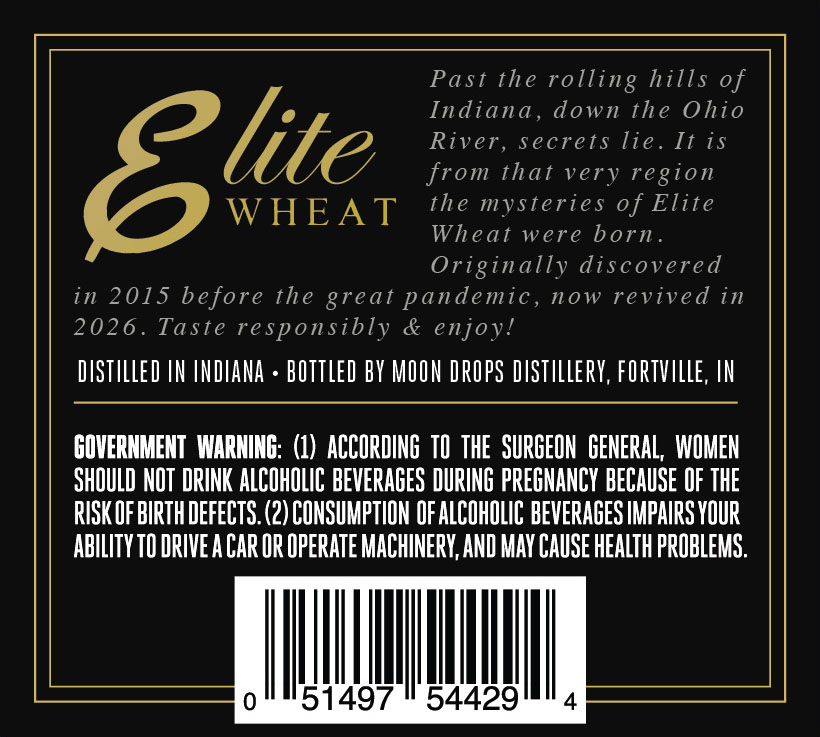
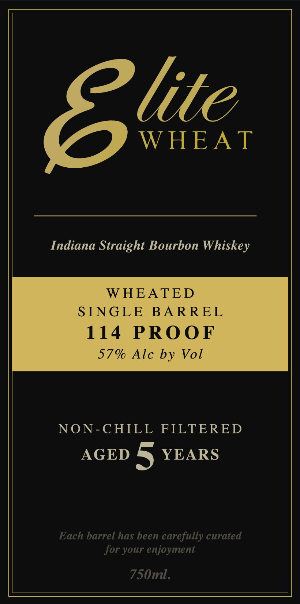

# TTB COLA Label Images - TTBID 26274001000389

**Brand Name:** ELITE

**Fanciful Name:** ELITE WHEAT

**Issue Date:** 10/09/2026

**Origin Code:** 19

**Product Class/Type:** 101

**Source:** [TTB Public COLA Registry](https://ttbonline.gov/colasonline/viewColaDetails.do?action=publicFormDisplay&ttbid=26274001000389)

## Label Images

### Back Label

### Front Label

## Extracted Label Text

*Text extracted via OCR - may contain errors*

**Detected Proof:** 114
**Detected Age:** 5 Years

### Back Label

Past the rolling hills of
Indiana , down the Ohio
8lite
River, secrets lie . It iS
from that very
region
WHEAT
the mysteries of Elite
Wheat were born.
Originally discovered
in 2015 before the
pandemic, now revived in
2026 .
Taste responsibly
& enjoy!
DISTILLED IN INDANA
bOTTLED BY MOON DROPS dISTLLeRY, FORTVILLE, IN
GOVERNMENT  WARNING: (1)  ACCORDING TO THE  SURGEON   GENERAL , WOMEN
SHOULD NOT DRINK ALCOHOLIC BEVERAGES DURING PREGHANCY BECAUSE OF THE
RISK OF BIRTHDEFECTS (2) CONSUMPTION OF ALCOHOLIC BEVERAGES IMPAIRS YOUR
ABILITY TO DRIVE A Car Or Operate MACHINERY,AND MaY CAUSE HEALTH PROBLEMS.
51497
54429
great

### Front Label

lite

WHEAT

Indiana Straight Bourbon Whiskey

WHEATED

SINGLE BARREL

114 PROOF

57% Alc by Vol

NON-CHILL FILTERED

AGED 5 YEARS

Each barrel has been carefully curated

for your enjoyment

750m.
