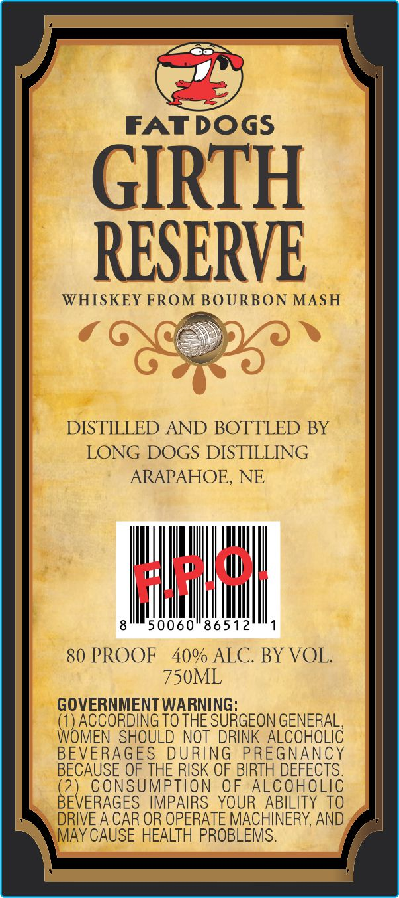
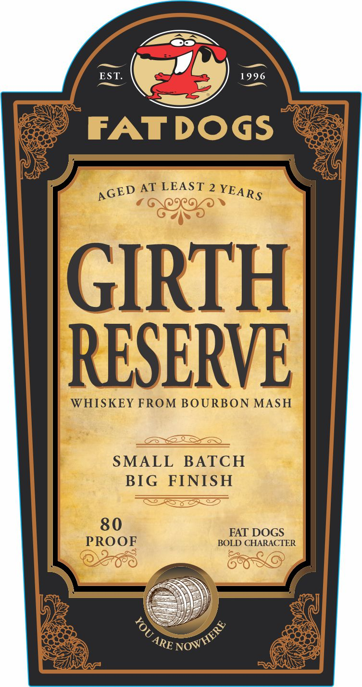

# TTB COLA Label Images - TTBID 26274001000658

**Brand Name:** LONG DOGS DISTILLING

**Fanciful Name:** FAT DOGS
GIRTH RESERVE

**Issue Date:** 10/08/2026

**Origin Code:** 31

**Product Class/Type:** 140

**Source:** [TTB Public COLA Registry](https://ttbonline.gov/colasonline/viewColaDetails.do?action=publicFormDisplay&ttbid=26274001000658)

## Label Images

### Back Label

### Front Label

## Extracted Label Text

*Text extracted via OCR - may contain errors*

**Detected Proof:** 80

### Back Label

FATDOGS
GIRTH
RESERVE
WHISKEY FROM BOURBON MASH
DISTILLED AND BOTTLED BY
LONG DOGS DISTILLING
ARAPAHOE, NE
50060"86512
80 PROOF
40% ALC. BY VOL.
750ML
GOVERNMENT WARNING:
(T) ACCORDING TO THE SURGEON GENERAL
WOMEN SHOULD NOT DRINK ALCOHOLIC
BEVERAGES
DURING
PREGNANCY
BECAUSE OF THE RISK OF BIRTH DEFECTS.
(2) CONSUMPTION
0F
ALCOHOLIC
BEVERAGES  IMPAIRS  YOUR ABILITY TO
DRIVE A CAR OR OPERATE MACHINERY, AND
MAY CAUSE HEALTH PROBLEMS.
Falsku

### Front Label

EST
1996
FAT DOGS
AT LEAST 2
GIRTH
RESERVE
WHISKEY FROM BOURBON MASH
SMALL
BATCH
BIG
FINISH
80
FAT DOGS
PROOF
BOLD CHARACTER
YEARS
AGED
8
NOWHERE
ARE
