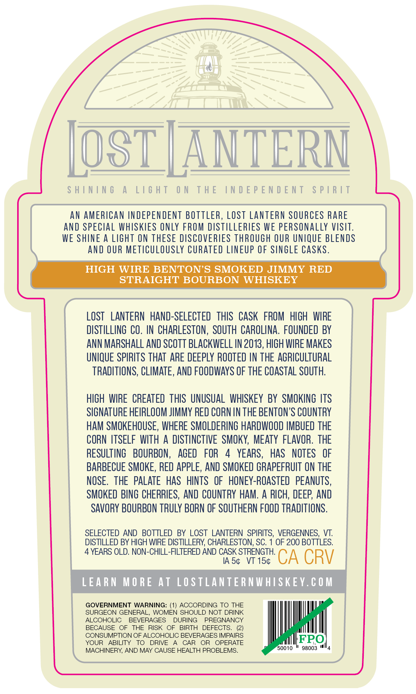
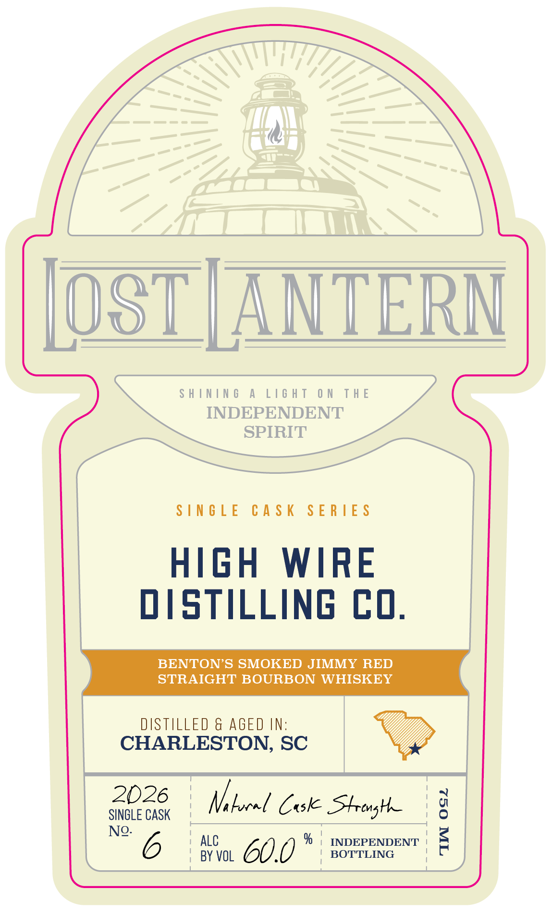
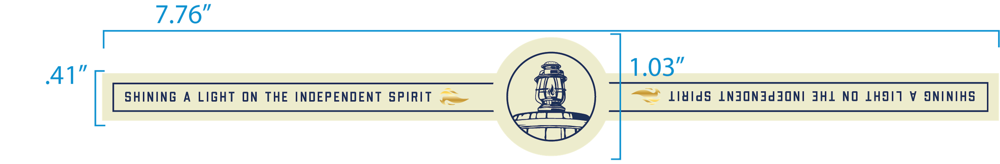

# TTB COLA Label Images - TTBID 26275001000092

**Brand Name:** LOST LANTERN

**Issue Date:** 10/28/2026

**Origin Code:** 46

**Product Class/Type:** 101

**Source:** [TTB Public COLA Registry](https://ttbonline.gov/colasonline/viewColaDetails.do?action=publicFormDisplay&ttbid=26275001000092)

## Label Images

### Back Label

### Front Label

### Label 2

## Extracted Label Text

*Text extracted via OCR - may contain errors*

**Detected Age:** 4 Years

### Back Label

SHINING A LIGHT ON THE INDEPENDENT SPIRIT
AN AMERICAN INDEPENDENT BOTTLER, LOST LANTERN SOURCES RARE
AND SPECIAL WHISKIES ONLY FROM DISTILLERIES WE PERSONALLY VISIT.
WE SHINE A LIGHT ON THESE DISCOVERIES THROUGH OUR UNIQUE BLENDS
AND OUR METICULOUSLY CURATED LINEUP OF SINGLE CASKS.
HIGH WIRE BENTON’S SMOKED JIMMY RED
STRAIGHT BOURBON WHISKEY
LOST LANTERN HAND-SELECTED THIS CASK FROM HIGH WIRE
DISTILLING CO. IN CHARLESTON, SOUTH CAROLINA. FOUNDED BY
ANN MARSHALL AND SCOTT BLACKWELL IN 2013, HIGH WIRE MAKES
UNIQUE SPIRITS THAT ARE DEEPLY ROOTED IN THE AGRICULTURAL
TRADITIONS, CLIMATE, AND FOODWAYS OF THE COASTAL SOUTH.

HIGH WIRE CREATED THIS UNUSUAL WHISKEY BY SMOKING ITS
SIGNATURE HEIRLOOM JIMMY RED CORN IN THE BENTON’S COUNTRY
HAM SMOKEHOUSE, WHERE SMOLDERING HARDWOOD IMBUED THE
CORN ITSELF WITH A DISTINCTIVE SMOKY, MEATY FLAVOR. THE
RESULTING BOURBON, AGED FOR 4 YEARS, HAS NOTES OF
BARBECUE SMOKE, RED APPLE, AND SMOKED GRAPEFRUIT ON THE
NOSE. THE PALATE HAS HINTS OF HONEY-ROASTED PEANUTS,
SMOKED BING CHERRIES, AND COUNTRY HAM. A RICH, DEEP, AND
SAVORY BOURBON TRULY BORN OF SOUTHERN FOOD TRADITIONS.
SELECTED AND BOTTLED BY LOST LANTERN SPIRITS, VERGENNES, VT.
DISTILLED BY HIGH WIRE DISTILLERY, CHARLESTON, SC. 1 OF 200 BOTTLES.

4 YEARS OLD. NON-CHILL-FILTERED AND CASK STRENGTH.

IAS¢ VT 15¢ CA CRV
LEARN MORE AT LOSTLANTERNWHISKEY.COM
GOVERNMENT WARNING: (1) ACCORDING TO THE
SURGEON GENERAL, WOMEN SHOULD NOT DRINK
ALCOHOLIC BEVERAGES DURING PREGNANCY
BECAUSE OF THE RISK OF BIRTH DEFECTS. (2)
CONSUMPTION OF ALCOHOLIC BEVERAGES IMPAIRS IFPO
YOUR ABILITY TO DRIVE A CAR OR OPERATE fetter
MACHINERY, AND MAY CAUSE HEALTH PROBLEMS. 0010 * 96003 "4

### Front Label

|[OST[ANTERN

SHINING A LIGHT ON THE

INDEPENDENT

SPIRIT

SINGLE CASK SERIES

HIGH WIRE

DISTILLING CO.

BENTON’S SMOKED JIMMY RED

STRAIGHT BOURBON WHISKEY

2026

SINGLE CASK

| Mibural Coske Shrongth

No. 6

' ALC

: BY VOL

60.0

% | INDEPENDENT |

BOTTLING

### Label 2

7.376"
41'
103"
ShInIng
A
LIGhT
ON
THE
INDEPENDENT
SpIRIT
lAIds
LNJONJdjoni JHL
NO
LHJIT
V
JNINIHS
