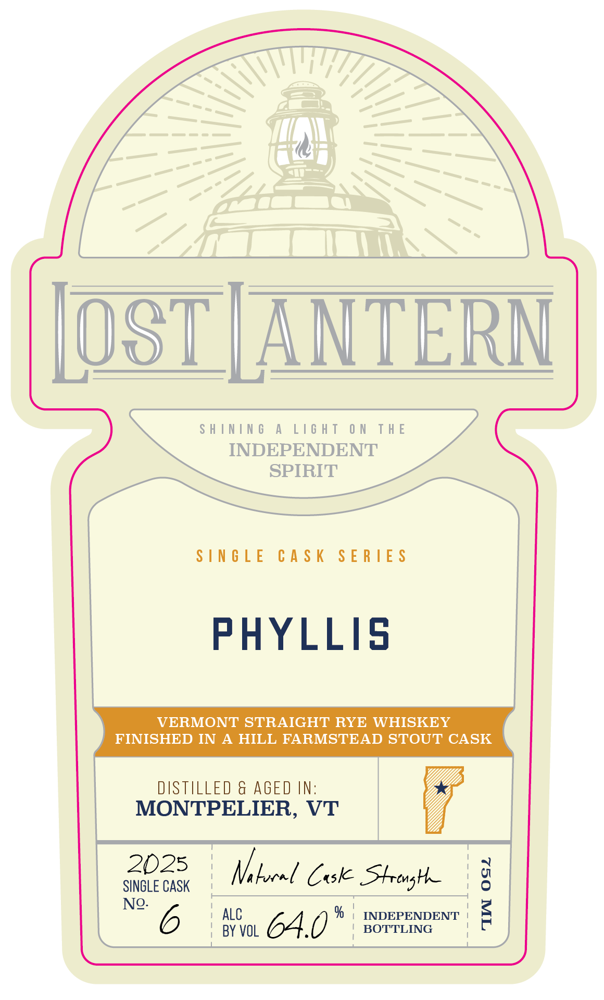
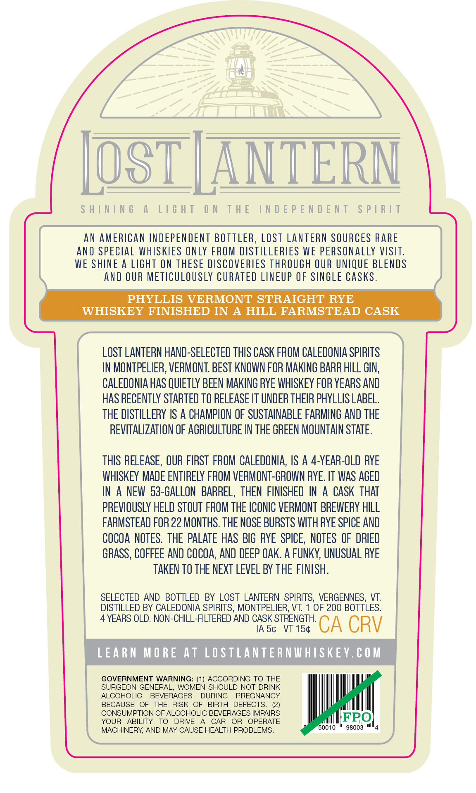

# TTB COLA Label Images - TTBID 26275001000093

**Brand Name:** LOST LANTERN

**Issue Date:** 10/08/2026

**Origin Code:** 46

**Product Class/Type:** 102

**Source:** [TTB Public COLA Registry](https://ttbonline.gov/colasonline/viewColaDetails.do?action=publicFormDisplay&ttbid=26275001000093)

## Label Images

### Front Label

### Label 2

### Label 3

## Extracted Label Text

*Text extracted via OCR - may contain errors*

**Detected Age:** 4 Years

### Front Label

OST | ANTERN

SHINING A LIGHT ON THE

INDEPENDENT

SPIRIT

SINGLE CASK SERIES

PHYLLIS

VERMONT STRAIGHT RYE WHISKEY

FINISHED IN A HILL FARMSTEAD STOUT CASK

DISTILLED & AGED IN:

MONTPELIER, VT

x

2025

1

1

qa

SINGLE CASK

Vi bocel Cuske SHtrenghe

!

°

ALC

INDEPENDENT <

I

No. 6

BY VOL

64.0°

| BOTTLING

t

### Label 2

SHINING A LIGHT ON THE INDEPENDENT SPIRIT
AN AMERICAN INDEPENDENT BOTTLER, LOST LANTERN SOURCES RARE
AND SPECIAL WHISKIES ONLY FROM DISTILLERIES WE PERSONALLY VISIT.
WE SHINE A LIGHT ON THESE DISCOVERIES THROUGH OUR UNIQUE BLENDS
AND OUR METICULOUSLY CURATED LINEUP OF SINGLE CASKS.
PHYLLIS VERMONT STRAIGHT RYE
WHISKEY FINISHED IN A HILL FARMSTEAD CASK
LOST LANTERN HAND-SELECTED THIS CASK FROM CALEDONIA SPIRITS
IN MONTPELIER, VERMONT. BEST KNOWN FOR MAKING BARR HILL GIN,
CALEDONIA HAS QUIETLY BEEN MAKING RYE WHISKEY FOR YEARS AND
HAS RECENTLY STARTED TO RELEASE IT UNDER THEIR PHYLLIS LABEL.

THE DISTILLERY IS A CHAMPION OF SUSTAINABLE FARMING AND THE
REVITALIZATION OF AGRICULTURE IN THE GREEN MOUNTAIN STATE.

THIS RELEASE, OUR FIRST FROM CALEDONIA, IS A 4-YEAR-OLD RYE
WHISKEY MADE ENTIRELY FROM VERMONT-GROWN RYE. IT WAS AGED
IN A NEW 53-GALLON BARREL, THEN FINISHED IN A CASK THAT
PREVIOUSLY HELD STOUT FROM THE ICONIC VERMONT BREWERY HILL
FARMSTEAD FOR 22 MONTHS. THE NOSE BURSTS WITH RYE SPICE AND
COCOA NOTES. THE PALATE HAS BIG RYE SPICE, NOTES OF DRIED
GRASS, COFFEE AND COCOA, AND DEEP OAK. A FUNKY, UNUSUAL RYE
TAKEN TO THE NEXT LEVEL BY THE FINISH.

SELECTED AND BOTTLED BY LOST LANTERN SPIRITS, VERGENNES, VT.
DISTILLED BY CALEDONIA SPIRITS, MONTPELIER, VT. 1 OF 200 BOTTLES.

4 YEARS OLD. NON-CHILL-FILTERED AND CASK STRENGTH.

IAS¢ VT 15¢ CA CRV

LEARN MORE AT LOSTLANTERNWHISKEY.COM
GOVERNMENT WARNING: (1) ACCORDING TO THE

SURGEON GENERAL, WOMEN SHOULD NOT DRINK

ALCOHOLIC BEVERAGES DURING PREGNANCY

BECAUSE OF THE RISK OF BIRTH DEFECTS. (2)

CONSUMPTION OF ALCOHOLIC BEVERAGES IMPAIRS IFPO
YOUR ABILITY TO DRIVE A CAR OR OPERATE fetter
MACHINERY, AND MAY CAUSE HEALTH PROBLEMS. 0010 * 96003 "4

### Label 3

7.376"
41'
103"
ShInIng
A
LIGhT
ON
THE
INDEPENDENT
SpIRIT
lAIds
LNJONJdjoni JHL
NO
LHJIT
V
JNINIHS
