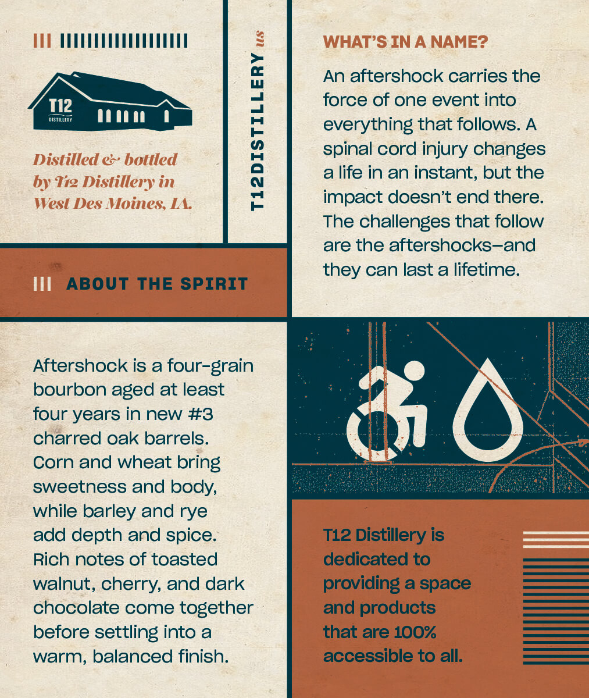
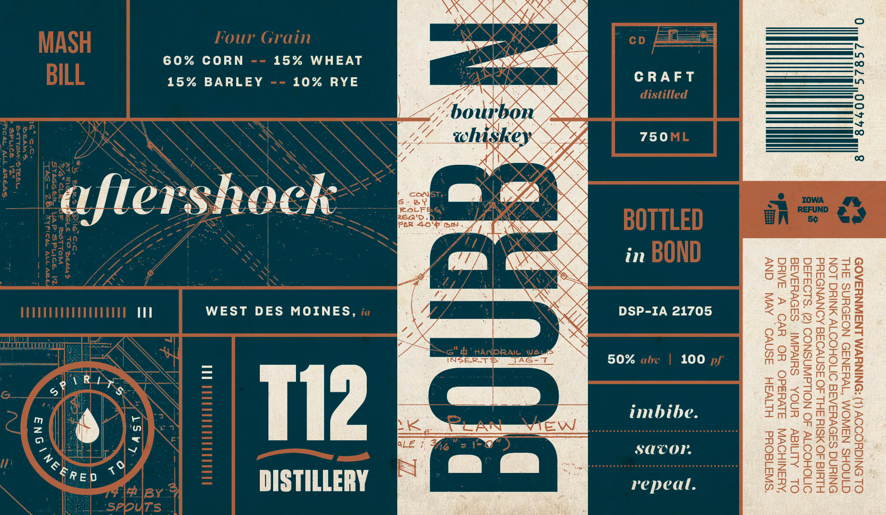

# TTB COLA Label Images - TTBID 26275001000370

**Brand Name:** T12 DISTILLERY

**Fanciful Name:** AFTERSHOCK BOURBON WHISKEY

**Issue Date:** 10/13/2026

**Origin Code:** 20

**Product Class/Type:** 111

**Source:** [TTB Public COLA Registry](https://ttbonline.gov/colasonline/viewColaDetails.do?action=publicFormDisplay&ttbid=26275001000370)

## Label Images

### Back Label

### Front Label

## Extracted Label Text

*Text extracted via OCR - may contain errors*

### Back Label

2
WHAT'S IN A NAME?
An aftershock carries the
T12
force of one event into
HIsTLLCY
1
everything that follows: A
Distilled & . bottled
spinal cord injury changes
a
life in an instant; but the
by Tig Dislillery in
West Des Moines; IA
impact doesnt end there:
The challenges that follow
are the aftershocks-and
they can last a lifetime:
III
ABOUT THE SPIRIT
Aftershock is a four-grain
bourbon aged at least
four years in new #3
charred oak barrels:
Corn and wheat bring
sweetness and body;
while barley and rye
add depth and spice.
T12 Distillery is
Rich notes of toasted
dedicated to
walnut, cherry; and dark
providing a space
chocolate come together
and products
before settling into a
that are 100%
warm, balanced finish:
accessible to all:

### Front Label

GOVERNMENT WARNING: (1) ACCORDING TO
THE SURGEON GENERAL, WOMEN SHOULD
NOT DRINK ALCOHOLIC BEVERAGES DURING
PREGNANCY BECAUSE OF THE RISK OF BIRTH

DEFECTS. (2) CONSUMPTION OF ALCOHOLIC
BEVERAGES IMPAIRS YOUR ABILITY TO
DRIVE A CAR OR OPERATE MACHINERY,
AND MAY CAUSE HEALTH PROBLEMS.

100

CRAFT
750

imbibe
savor.
repeal

in

DSP-IA 21705

REE

15% WHEAT
% RYE
y

10
0)
©

Ss
> HE
=
a
es | =
[=]

WEST DES MOINES,

15% BARLEY
Ni
Ay

60% CORN

LS y.

L
Ss
8

4

<g

y
g\ Ri»
rc)
RED

x
Enc’
