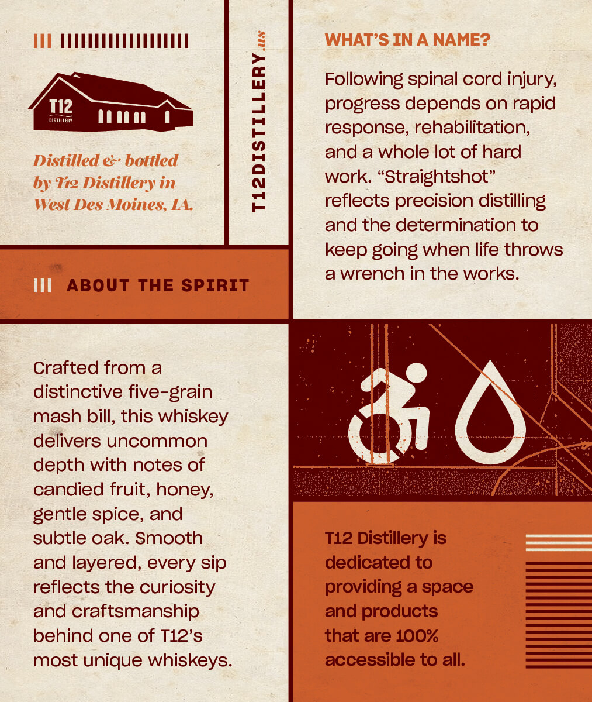
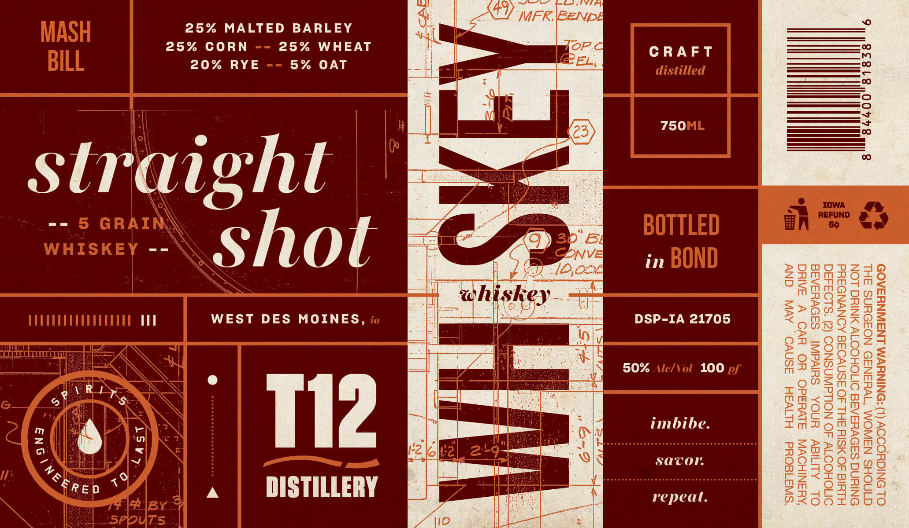

# TTB COLA Label Images - TTBID 26275001000392

**Brand Name:** T12 DISTILLERY

**Fanciful Name:** STRAIGHT SHOT WHISKEY

**Issue Date:** 11/06/2026

**Origin Code:** 20

**Product Class/Type:** 119

**Source:** [TTB Public COLA Registry](https://ttbonline.gov/colasonline/viewColaDetails.do?action=publicFormDisplay&ttbid=26275001000392)

## Label Images

### Back Label

### Front Label

## Extracted Label Text

*Text extracted via OCR - may contain errors*

### Back Label

TET

Following spinal cord injury,

progress depends on rapid

=>

response, rehabilitation,

and a whole lot of hard

work. “Straightshot”

reflects precision distilling

and the determination to

keep going when life throws

=

ABOUT THE SPIRIT

a wrench in the works.

It

Crafted froma

distinctive five-grain

mash bill, this whiskey

delivers uncommon

depth with notes of

candied fruit, honey,

gentle spice, and

subtle oak. Smooth

T12 Distillery is

dedicated to

and layered, every sip

reflects the curiosity

providing a space

and craftsmanship

and products

behind one of T12’s

that are 100%

accessible to all.

most unique whiskeys

### Front Label

25% MALTED BARLEY

25% CORN
20% RYE

25% WHEAT
5% OAT

straight
“Shot

WEST DES MOINES,

(Rt
3} *

\ONa

4

¢ S

4

fast

A

Tl2

DISTILLERY

CRAFT

750

in

DSP-IA 21705

50% 100

imbibe.
savor.

repeal.

>
Zz
0
$
x

o
a
=
m
>
fe)
>
Bo)
(2)
D
e)
U
mm
5
m
=
>
fe)
ne
Zz
m
QD
K

SaDVvusAsa

“SWA18OUd =HLIVAH ASNVO
OMOHOONW 3O NOLLAWASNOOD (2) ‘S.LO34350

HLYIs 40 SIX SH.L AO ASNVOAE AONVNDSkd

ONIN SSDVHSASE OMOHOOTV NING LON
OL DNIGHOOOY (1) *DNINYVM LNSIINYSAOD

GINOHS NAWOM “WHANa5D NOSDYNS SHL

OL ALMIGY YNOA SHIVdINI
