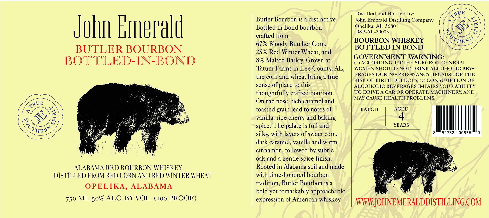

# TTB COLA Label Images - TTBID 26275001000403

**Brand Name:** JOHN EMERALD

**Fanciful Name:** BUTLER BOURBON

**Issue Date:** 10/19/2026

**Origin Code:** 10

**Product Class/Type:** 111

**Source:** [TTB Public COLA Registry](https://ttbonline.gov/colasonline/viewColaDetails.do?action=publicFormDisplay&ttbid=26275001000403)

## Label Images

### Label 1

## Extracted Label Text

*Text extracted via OCR - may contain errors*

**Detected Proof:** 100
**Detected Age:** 4 Years

### Label 1

UE

Distilled and Bottled by:

Butler Bourbon is a distinctive

John Emerald Distilling Company

Bottled in Bond bourbon

Opelika, AL 36801

Jofin Emerald

crafted from

DSP-AL-20003

BOURBON WHISKEY

PHE®

67% Bloody Butcher Corn,

BOTTLED IN BOND

BUTLER BOURBON

25% Red Winter Wheat, and

GOVERNMENT WARNING:

BOTTLED-IN-BOND

8% Malted Barley. Grown at

(1) ACCORDING TO THE SURGEON GENERAL,

‘Tatum Farms in Lee County, AL,

WOMEN SHOULD NOT DRINK ALCOHOLIC BEV-

the corn and wheat bring a true

ERAGES DURING PREGNANCY BECAUSE OF THE

RISK OF BIRTH DEFECTS, (2) CONSUMPTION OF

sense of place to this

ALCOHOLIC BEVERAGES IMPAIRS YOUR ABILITY

thoughtfully crafted bourbon.

‘TO DRIVE A CAR OR OPERATE MACHINERY, AND

On the nose, rich caramel and

MAY CAUSE HEALTH PROBLEMS.

Que

AGED

toasted grain lead to notes of

BATCH

vanilla, ripe cherry and baking

4

YEARS

Guiy

spice. The palate is full and

VM

silky, with layers of sweet corn,

dark caramel, vanilla and warm

|

cinnamon, followed by subtle

oak and a gentle spice finish.

Fe)

ALABAMA RED BOURBON WHISKEY

Rooted in Alabama soil and made

DISTILLED FROM RED CORN AND RED WINTER WHEAT

with time-honored bourbon

tradition, Butler Bourbon is a

OPELIKA, ALABAMA

bold yet remarkably approachable

750 ML 50% ALC. BY VOL. (100 PROOF)

expression of American whiskey.

WTWNLJORNENERALDDISTILLINGCOM
