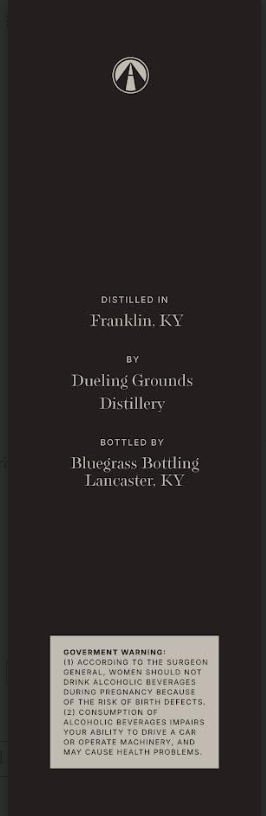
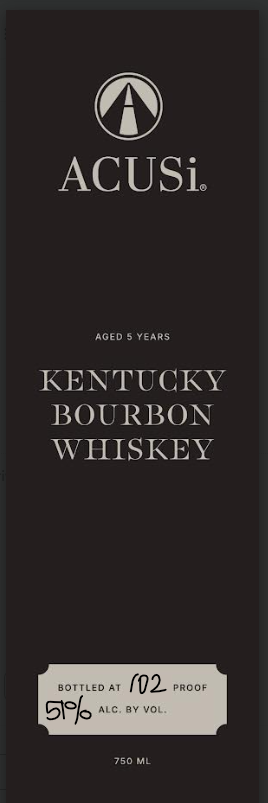

# TTB COLA Label Images - TTBID 26275001000430

**Brand Name:** ACUSI

**Issue Date:** 10/08/2026

**Origin Code:** 22

**Product Class/Type:** 141

**Source:** [TTB Public COLA Registry](https://ttbonline.gov/colasonline/viewColaDetails.do?action=publicFormDisplay&ttbid=26275001000430)

## Label Images

### Back Label

### Front Label

## Extracted Label Text

*Text extracted via OCR - may contain errors*

### Back Label

distilled IN
Franklin; KY
Dueling Grounds
Distillery
DOTTLED DY
Bluegrass Bottling
Lancaster; KY
caverment Warning
AccokBINC
SuRGLON
GEMERAL
Govd
ShCULD HoT
DRIRR Acoholic
VLRRGES
DUMNC PNECNANCT
DECAUSE
BIR Th
DEFECTE
Mlconsuketoh
CchuLIC
AEVERAGE
upiias
TCUF
ABiLIT
TC DKIYI
OPERAT
VRGHINERY
CAUSE HEALIM '4OBLENS

### Front Label

ACUSi
AGED
Years
KENTUCKY
BOURBON
WHISKEY
BoTTLED AT
(02
PRoOF
Si
ALC
8Y Vol:
750 ML
