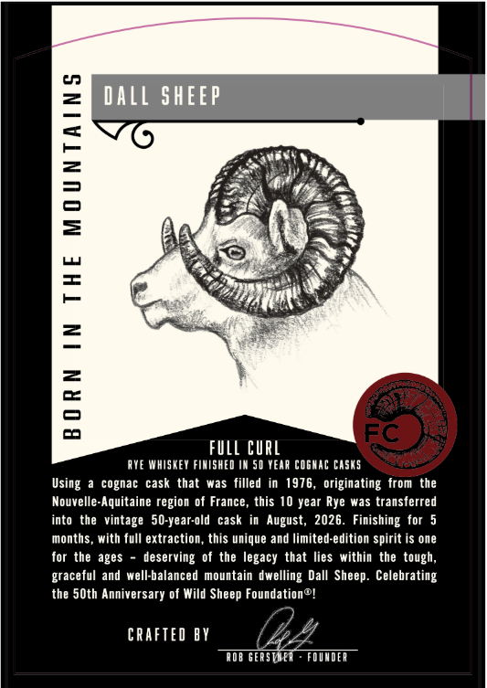
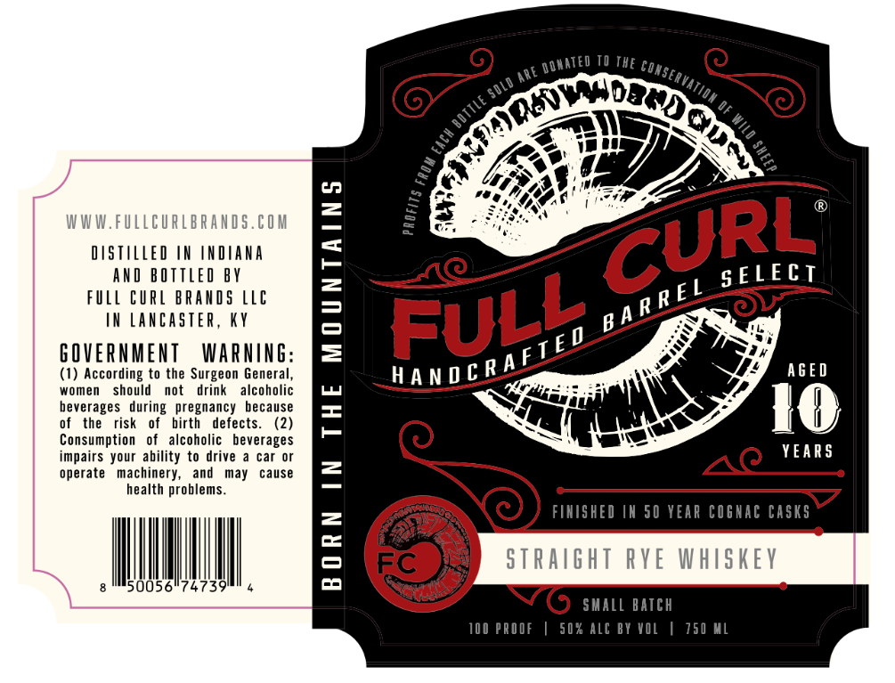

# TTB COLA Label Images - TTBID 26275001000452

**Brand Name:** FULL CURL

**Issue Date:** 10/14/2026

**Origin Code:** 22

**Product Class/Type:** 102

**Source:** [TTB Public COLA Registry](https://ttbonline.gov/colasonline/viewColaDetails.do?action=publicFormDisplay&ttbid=26275001000452)

## Label Images

### Back Label

### Front Label

## Extracted Label Text

*Text extracted via OCR - may contain errors*

**Detected Proof:** 100
**Detected Age:** 10 Years

### Back Label

c
Dall SHEEP
1
2
=
P
7
3
2
:
0
fulL CURL
AYE Whisket FIMISHED IM 50 TEAR COGHAC Casks
Using
cognac cask that
was filled  in  1976_
originating   from  the
Nouvelle-Aquitaine region of France, this 10 year Rye was transferred
into   the vintage   50-year-old
August, 2026. Finishing for 5
Months_
with full extraction , this unique and limited-edition
is one
forthe ages
deserving of the legacy that lies within the tough,
graceful and well-balanced  mountain  dwelling Dall  Sheep: Celebrating
the SOth Anniversary of Wild Sheep Foundation%!
CRAFTEd BY
0Ob GEASTuEA
FDUMDER
cask
spirit

### Front Label

04
WWW.FULLcurlbrands.€OM
DSTLLEd IN IndAna
FULLMNEURQ MREVOBYLLE

SELECT
IX Lancaster,
KY
6OverNMenT
Warning:
(1) According to the Surgeon General,
AGED
women
should
not
drink
alcoholic
beverages   during
pregnancy because
F
KO
the
risk
birth
defects
Consumption
of   alcoholic   beverages
impairs your ability to drive
car Or
YEARS
operate   machinery,
and
may
cause
2
health problems.
FIHISHED IK 50 YEAR Cosnac casks
1
ST Raght RVe WhIskev
50056
74739
shalL batch
100 PROOF
50% Alc BY VOL
150 ML
~DDMATEd
ThE
conservation _
Re
~SOLd
~botile
1
1
1
1
1
CURL'
Full
B A R R E L
handcRAFTEO
