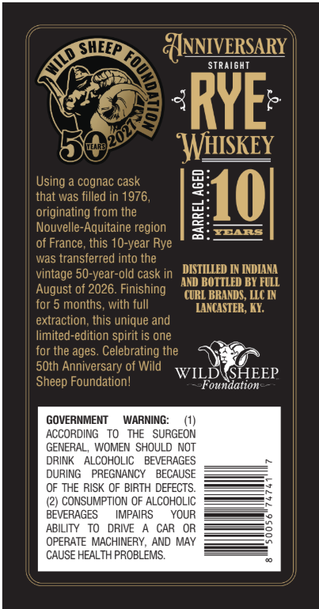
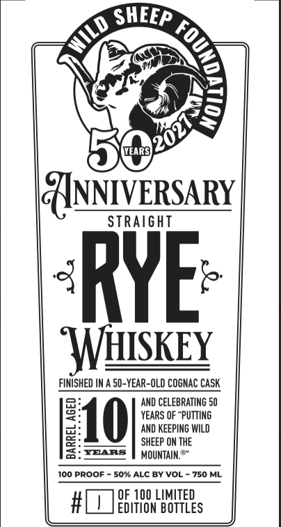

# TTB COLA Label Images - TTBID 26275001000454

**Brand Name:** WILD SHEEP FOUNDATION

**Issue Date:** 10/20/2026

**Origin Code:** 22

**Product Class/Type:** 102

**Source:** [TTB Public COLA Registry](https://ttbonline.gov/colasonline/viewColaDetails.do?action=publicFormDisplay&ttbid=26275001000454)

## Label Images

### Back Label

### Front Label

## Extracted Label Text

*Text extracted via OCR - may contain errors*

**Detected Proof:** 100
**Detected Age:** 10 Years

### Back Label

OSHi
ANNIVERSARY
STRAIGHT
RYE
WHISKEY
Using
cognac cask
8
that was filled in 1976,
10
originating from the
Nouvelle-Aquitaine region
1
YEARS
of France, this 10-year Rye
was transferred into the
vintage
old cask in
DISTILLED IN INDIANA
AND BOTTLED BY FULL
August of 2026. Finishing
CURL BRANDS , LLIC IN
for 5 months, with full
TANCASTER, KY
extraction; this unique and
limited-edition spirit is one
for the ages. Celebrating the
5Oth Anniversary of Wild
WILDWSHEEP
Sheep Foundation!
Pfoundatione
GOVERNMENT
WARNING:
ACCORDING
To   THE   SURGEON
GENERAL,
WOMEN SHOULD NOT
DRINK
ALCOHOLIC
BEVERAGES
DURING
PREGNANCY
BECAUSE
OF THE RISK OF BIRTH DEFECTS
CONSUMPTION OF ALCOHOLIC
BEVERAGES
IMPAIRS
YOUR
ABILITY
DRIVE
CAR
OPERATE MACHINERY
AND MAY
CAUSE HEALTH PROBLEMS.
50-year-c

### Front Label

0
SHEEP
WEARS
{NNIVERSARY
STRaight
RYE
WSKEY
FINISHED IN A 50-YEAR-OLD COGNAC CASK
AND CELEBRATING 50
8
10
YEARS OF "PUTTING
AND KEEPING WILD
1
SHEEP ON THE
YEARS
MOUNTAIM %"
100 PROOF
50% ALC BY VOL
750 ML
OF 100 LIMITED
EDITION BOTTLES
1
