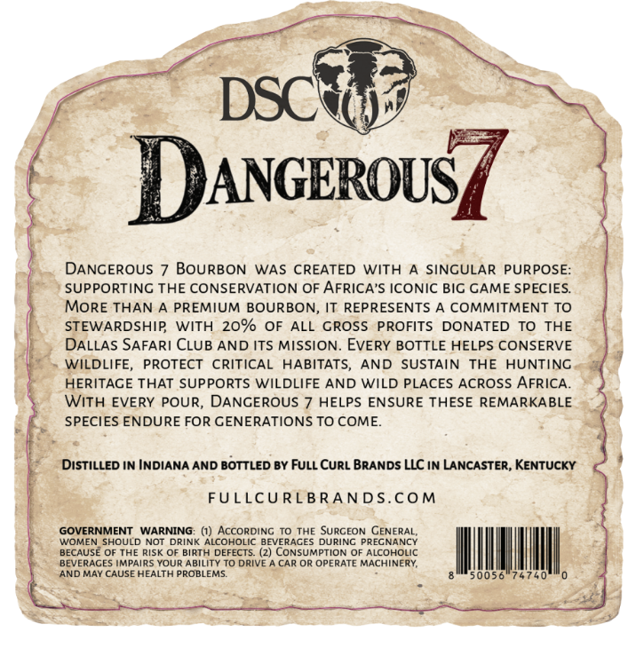
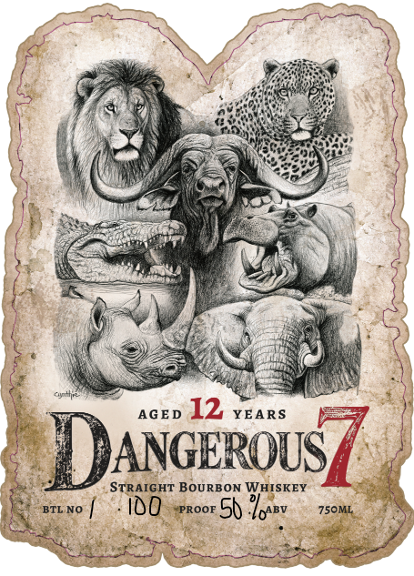

# TTB COLA Label Images - TTBID 26275001000457

**Brand Name:** DANGEROUS 7

**Issue Date:** 10/21/2026

**Origin Code:** 22

**Product Class/Type:** 101

**Source:** [TTB Public COLA Registry](https://ttbonline.gov/colasonline/viewColaDetails.do?action=publicFormDisplay&ttbid=26275001000457)

## Label Images

### Back Label

### Front Label

## Extracted Label Text

*Text extracted via OCR - may contain errors*

### Back Label

DSCE
DANGEROUS
DANCEROUS
BOURBON WAS CREATED WITH
SINCULAR PURPOSE:
SUPPORTINC THE CONSERVATION OF AFRICA'S ICONIC BIC CAME SPECIES
MORE THAN
PREMIUM BOURBON_
IT REPRESENTS A
COMMITMENT TO
STEWARDSHIP
WITH 20% OF ALL GROSS PROFITS DONATED TO THE
DALLAS SAFARI CLUB AND ITS MISSION: EVERY BOTTLE HELPS CONSERVE
WILDLIFE,
PROTECT
CRITICAL
HABITATS,
AND
SUSTAIN
THE
HUNTINC
HERITACE THAT SUPPORTS WILDLIFE AND WILD PLACES ACROSS AFRICA
With EVERY POUR, DANCEROUS
HELPS ENSURE THESE REMARKABLE
SPECIES ENDURE FOR CENERATIONS TO COME
DIStILLED IN INDIANA AND BOTTLED BY FULL CURL BRANDS LLC IN LANCASTER, KENTUCKY
FULLCURLBRANDS.COM
GOVERNMENT
WARNING:
AccORDINGC To THE SURCEON GENERAL;
WOMEN SHOULD NOT DRINK ALCOHOLIC BEVERACES DURINC PRECNANCY
BECAUSE OF THE Risk OF BIRTH DEFECTS. (2) CONSUMPTION OF ALcOHOLIC
BEVERACES IMPAIRS YOUR ABILITY TO DRIVE
CAR OR OPERATE MACHINERY
ANDMAY CAUSE HEALTA PROBLEMS:
50056
740

### Front Label

AGED YEARS

DANGEROUS

STRAIGHT BOURBON WHISKEY “=

100 roor Sh Topsy 150m,
