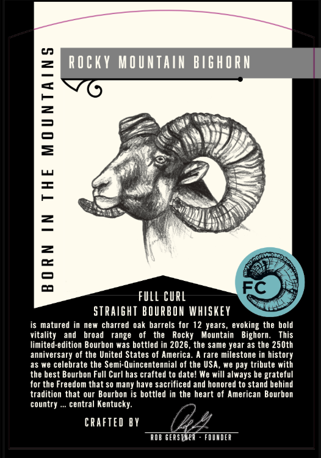

# TTB COLA Label Images - TTBID 26275001000463

**Brand Name:** FULL CURL

**Issue Date:** 10/26/2026

**Origin Code:** 22

**Product Class/Type:** 101

**Source:** [TTB Public COLA Registry](https://ttbonline.gov/colasonline/viewColaDetails.do?action=publicFormDisplay&ttbid=26275001000463)

## Label Images

### Back Label

## Extracted Label Text

*Text extracted via OCR - may contain errors*

**Detected Age:** 12 Years

### Back Label

02
ROcky MOUNTain BIGhORN
1
3
2
4
2
2
5
0J
FuLL CuRL
STRaIght BOURBOH whISkeY
is matured in
new charred oak barrels for 12 years, evoking the bold
vitality
and
broad
range
the
Rocky
Mountain
Bighorn_
This
limited-edition Bourbon was bottled in 2026
the same year as the 25Oth
anniversary of the United States of America_
rare milestone in history
as we celebrate the Semi-Quincentennial of the USA, we pay tribute with
the best
Bourbon Full Curl has crafted to date! We will always be grateful
for the Freedom that so many have sacrificed and honored to stand behind
tradition that our Bourbon is bottled in the heart of American Bourbon
country
central Kentucky:
CRAFTEd BY
ROB GERSTVEA
FDUVDEA
