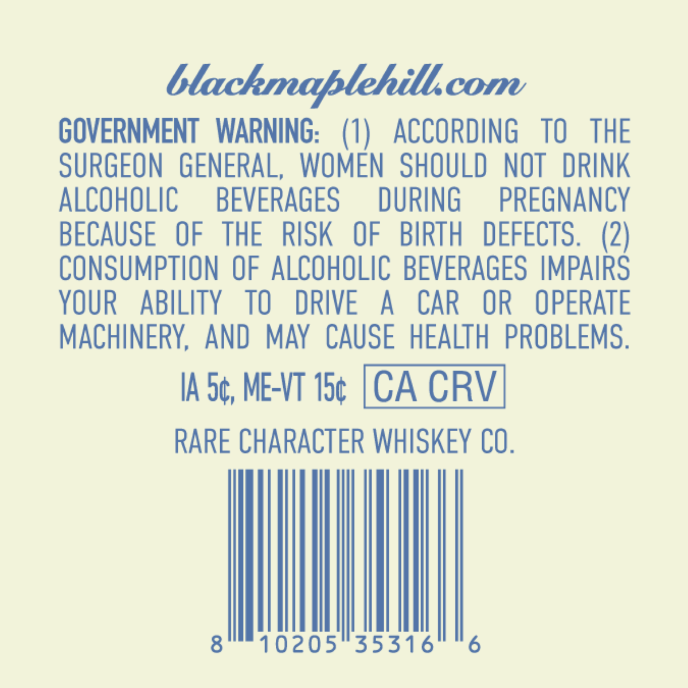
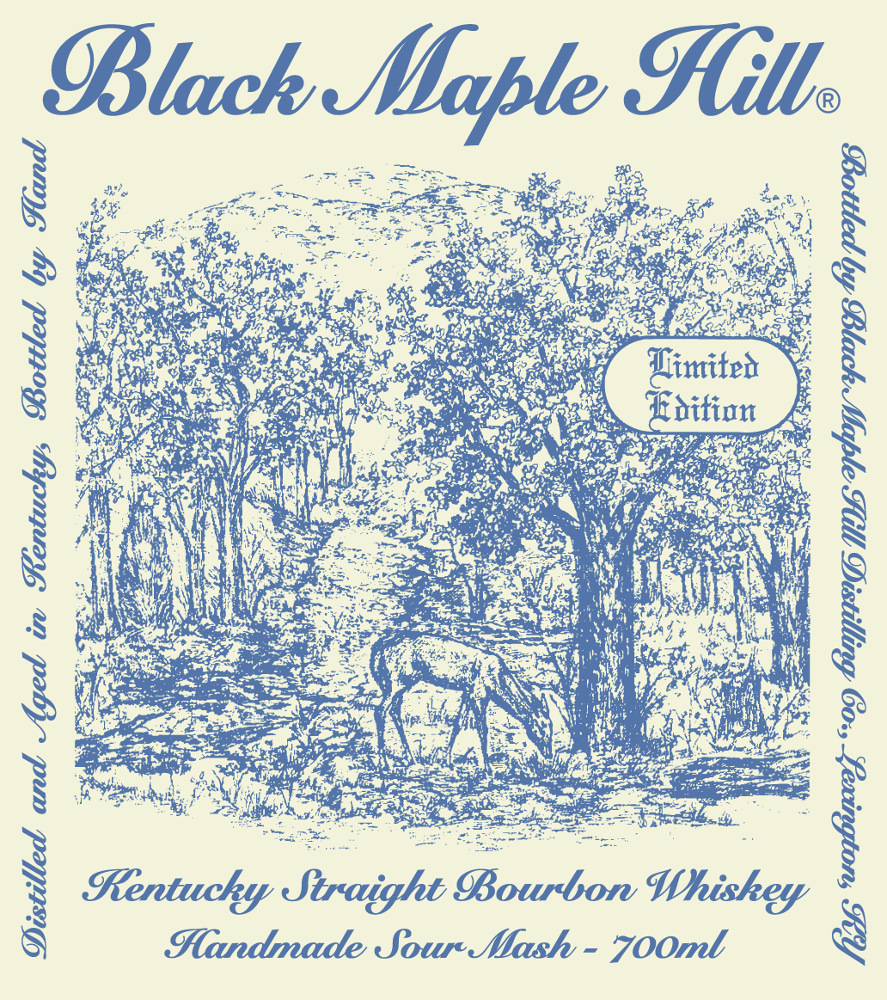
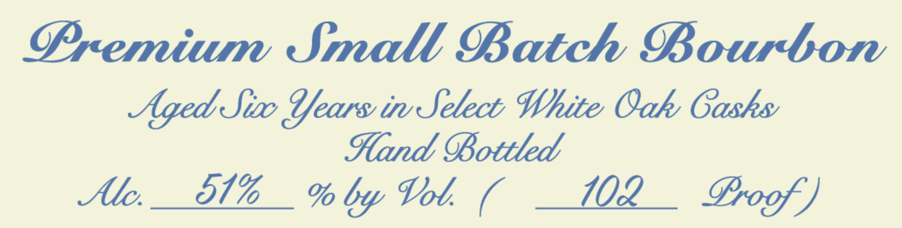

# TTB COLA Label Images - TTBID 26275001000564

**Brand Name:** BLACK MAPLE HILL

**Issue Date:** 10/14/2026

**Origin Code:** 22

**Product Class/Type:** 101

**Source:** [TTB Public COLA Registry](https://ttbonline.gov/colasonline/viewColaDetails.do?action=publicFormDisplay&ttbid=26275001000564)

## Label Images

### Back Label

### Label 1

### Label 3

## Extracted Label Text

*Text extracted via OCR - may contain errors*

**Detected Proof:** 102

### Back Label

tlackmablehill.
GOVERNMENT WARNING: (1) ACCORDING TO THE
SURGEON GENERAL, WOMEN SHOULD NOT DRINK
ALCOHOLIC BEVERAGES DURING PREGNANCY
BECAUSE OF THE RISK OF BIRTH DEFECTS. (2)
CONSUMPTION OF ALCOHOLIC BEVERAGES IMPAIRS
YOUR ABILITY TO DRIVE A CAR OR OPERATE
MACHINERY, AND MAY CAUSE HEALTH PROBLEMS.
IA 5¢, ME-VT the [CA CRV
RARE CHARACTER WHISKEY CO.
Wt

### Label 1

®
ae wo ee = S55. OK as
: Fe ge ce NT oe
Sue = oy, Fos Sear? ge? ees ge Ped
SY PA OR pedi ANGE Ee Lg BS at Tae
PERIINR Tar i as, Sie Sel ane gE a 3
ne OR a fy eg RE paar Cie eae alee PS ee mes
COW oer 28 os eens thition 4
Mme ia Nea ian ary sete
iC EN PGNY gO nee Nees en, es:
pee LN AUN weep Pk Se oes,
AT AVS it be Sees a Oy Mee G
Bee NVA Wess Saleen cy oc ha NY feo oe ay
VEN 7 i i ee yer See. ye Sap aly
hae HAN SN Kee Ge, grea Shee ‘if aa Heian i
Pe ER, or Sa Oe il tM ( aya ly ;
Se eae Ee ee Co) LA aN
Ne ee a Pct Sse ES
eee 8 Pa RCI a
Vip Settee ear ed 1 AN SN TM Cee Pi
es eecen ee he LR i tikcap A: RO Servic? f AE KS
pe oe ee ea 0 OC?
Beiter Ne ae a la A ge acer s
Riven iat Bi Meg Mags ANSE elle Cher acer oa
a NN eG ar rae gi ee ee
Handmade Sour-Mash - 7OOmt 8

### Label 3

Oremium Small Batch BBourbon
Aged Sibo Sears ir Setecb White Oak Gasks
%land OBottled
Alc
51%
% by Vol
102
Erogf )
