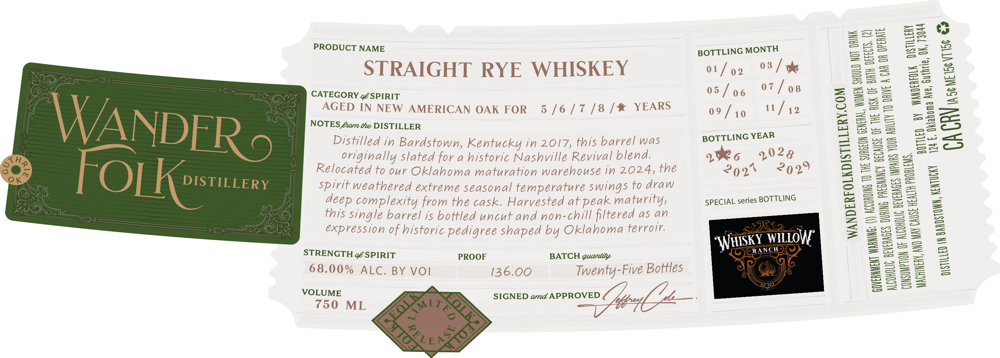

# TTB COLA Label Images - TTBID 26275001000602

**Brand Name:** WANDERFOLK DISTILLERY

**Issue Date:** 10/08/2026

**Origin Code:** 37

**Product Class/Type:** 102

**Source:** [TTB Public COLA Registry](https://ttbonline.gov/colasonline/viewColaDetails.do?action=publicFormDisplay&ttbid=26275001000602)

## Label Images

### Label 1

## Extracted Label Text

*Text extracted via OCR - may contain errors*

**Detected Proof:** 136

### Label 1

PRODUCT NAME

STRAIGHT RYE WHISKEY

OEE ne.
ED IN NE
W AMER
N ICA
OTES fan he DISTILLER N OAK FOR 5/6/7/8/% YEARS

Distilled /.
éd in Bardstow
originall n, Kentucky in 20 :
Relocated to fe oe for a historic Cee arte
_ weathered = maturation ee h
éép com fase reme seasonal tem Z 24, the
this single bani iebowied ore ee
is bottled uncut and non see
= eved as an

expression of :

historic .

pedigree

STRENGTH SPIRIT gieeshaped by OkaloMa terroir.

68.00% ALC. BY VOI =n

BATCH quantity

136. 5
VOLUME 00 Twenty-Five Bottles

750

BOTTLING MONTH
o1/ 92 03 / oe
05/o6 7/08
09/10 1/42

BOTTLING YEAR

yo 1028
292% 02%

SPECIAL series BOTTLING

ISTILLERY.COM
SURGEON QENERKL

BECAUSE OF THE A

WANDERFOLKD

NOT ORINK

EFECIS. (2)
QR OPERATE

WOMEN SHOULD

ACCORDING 10 THE

Sk OF BIRTH
TO ORE A CAR

\

PTION OF

CONSY

Tae C8

Guthrie, OK, 73044

CACRY Noe ME TEC

1

TTLED BY WANDERFOLK DISTILLERY
Jahoma Ave

0
24 E, OM

(TH PROBLEMS.
b

CAUSE HE
DISTILLED IN BARDSTONN, KENTUCKY

AND MAY

WAACHINERY,
