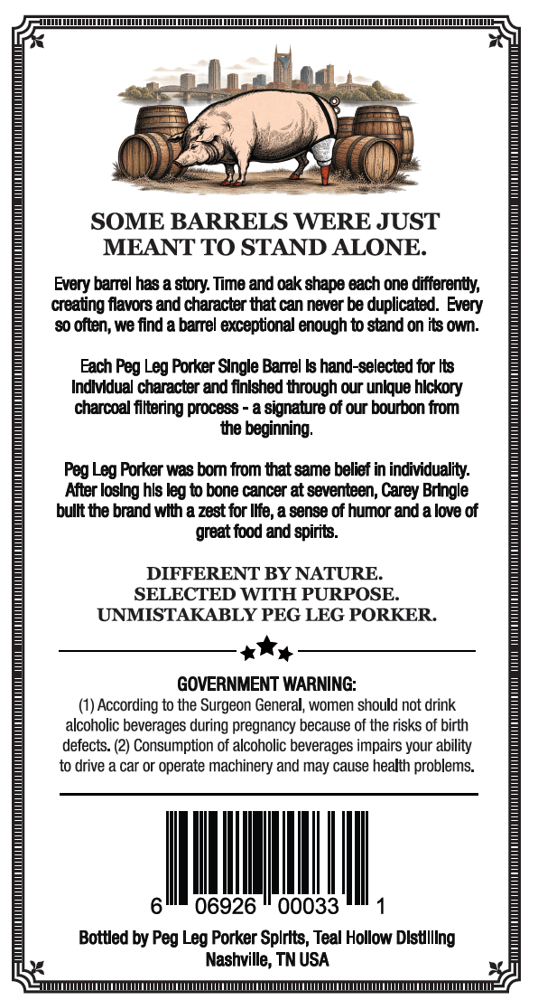
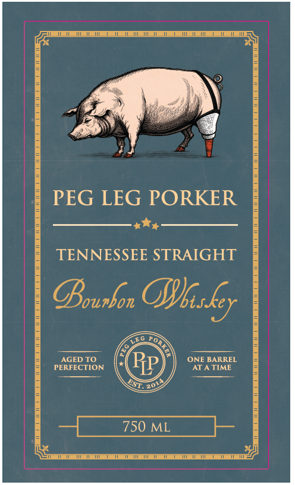
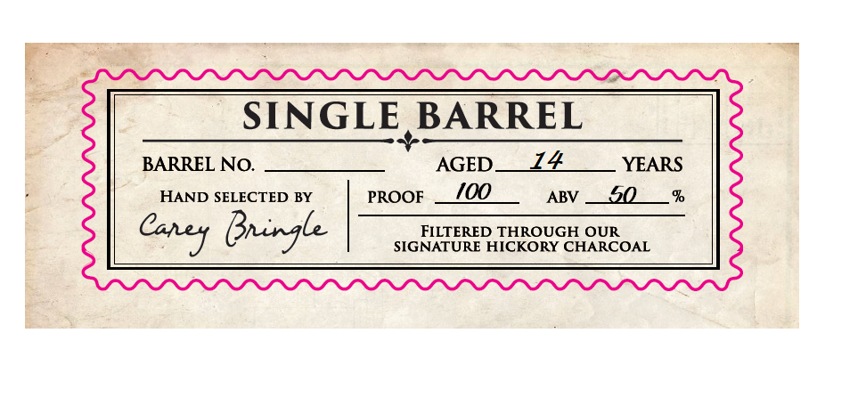

# TTB COLA Label Images - TTBID 26275001000613

**Brand Name:** PEG LEG PORKER

**Issue Date:** 10/26/2026

**Origin Code:** 43

**Product Class/Type:** 101

**Source:** [TTB Public COLA Registry](https://ttbonline.gov/colasonline/viewColaDetails.do?action=publicFormDisplay&ttbid=26275001000613)

## Label Images

### Back Label

### Front Label

### Label 2

## Extracted Label Text

*Text extracted via OCR - may contain errors*

**Detected Age:** 14 Years

### Back Label

SOME BARRELS WERE JUST
MEANT TO STAND ALONE.
Every barrel has a story: Time and oak shapa each one differentfy
creating flavors and character that can never be duplicated. Every
80 often; we find a barrel exceptional enough t0 stand on its own_
Each Peg Leg Forker Slngle Banrel ks hand-selected for Its
Indlvdual character &nd finlshed through our unlque hlckory
charcoal filtering process
a signature of our bourbon from
the beginning:
Leg Forker was bom from tat same belief in individuality:
Ajer loslng hls leg to bone cancer at seventeen; Carey BrIngle
bullt the brand wlth a zest for Iife, a sense of humor and a love of
great food and spirits
DIFFERENT BY NATURE.
SELECTED WITH PURPOSE.
UNMISTAKABLY PEG LEG PORKER.
GOVERNMENT WARNING:
According to the Surgeon General; women should not drink
alcoholic beverages
pregnancy because of the risks of birth
defects: (2) Consumption of alcoholic beverages impairs your ability
to drive a car or operate machinery and may cause health problems
06926
00033
Bottled by
Leg Porker Splrits, Teal Hollow Dlstllllng
Nashville; TN USA
Peg
' during'
Peg

### Front Label

PEG LEG PORKER

+O

TENNESSEE STRAIGHT

Darker Dib sky

AGED TO ‘ONE BARREL
PERFECTION AT ATIME

### Label 2

SINGLE BARREL
BARREL NO:
AGED_
14
YEARS
HAND SELECTED BY
PROOF
I0Q
ABV
50
Bningle
FILTERED THROUGH OUR
SIGNATURE HICKORY CHARCOAL
Calej
