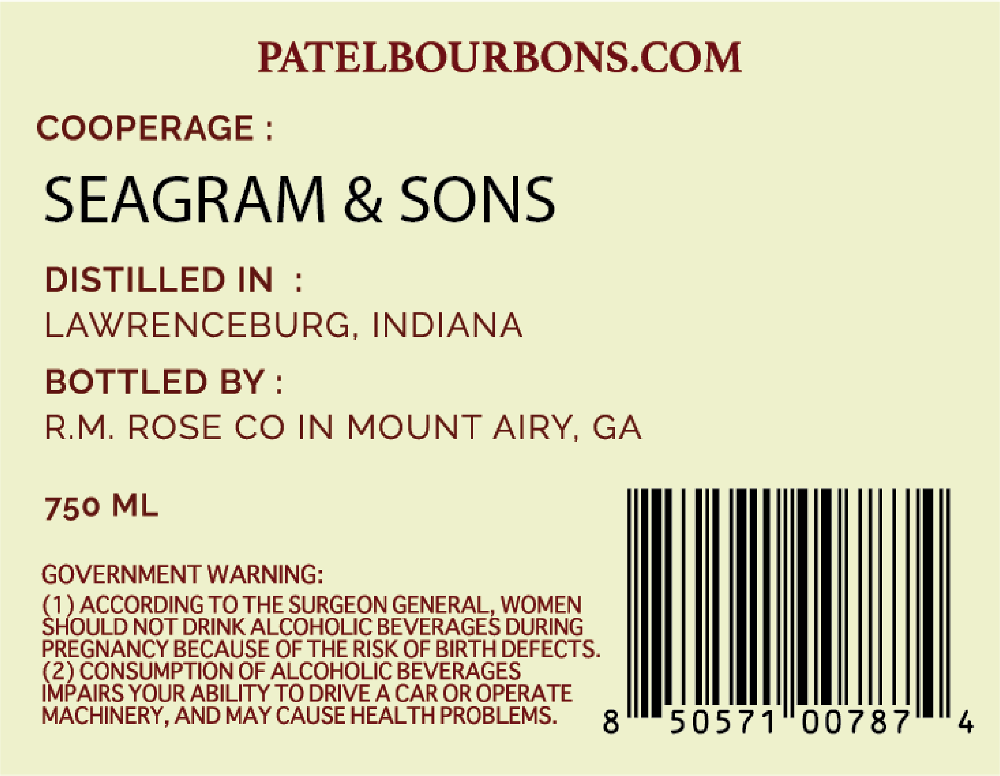
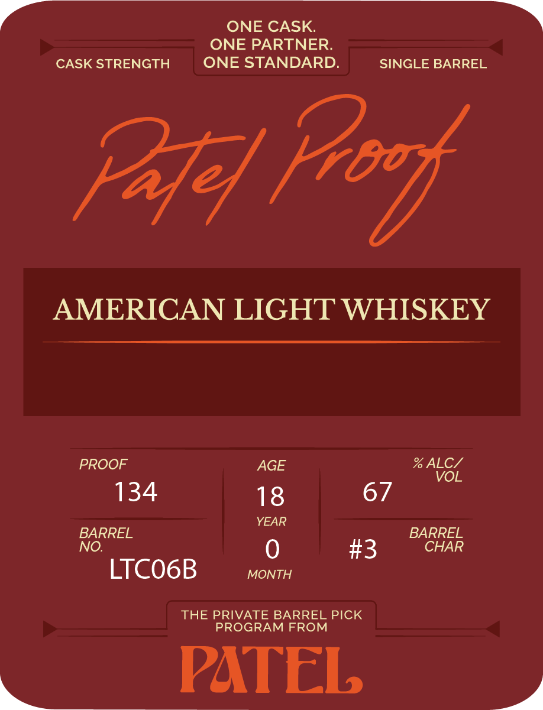

# TTB COLA Label Images - TTBID 26276001000005

**Brand Name:** PATEL PROOF

**Issue Date:** 10/14/2026

**Origin Code:** 08

**Product Class/Type:** 144

**Source:** [TTB Public COLA Registry](https://ttbonline.gov/colasonline/viewColaDetails.do?action=publicFormDisplay&ttbid=26276001000005)

## Label Images

### Back Label

### Front Label

## Extracted Label Text

*Text extracted via OCR - may contain errors*

### Back Label

PATELBOURBONS.COM

COOPERAGE :
SEAGRAM & SONS
DISTILLED IN :
LAWRENCEBURG, INDIANA
BOTTLED BY :

R.M. ROSE CO IN MOUNT AIRY, GA

(2) CONSUMPTION OF ALCOHOLIC BEVERAGES
IMPAIRS YOUR ABILITY TO DRIVE A CAR OR OPERATE
MACHINERY, AND MAY CAUSE HEALTH PROBLEMS.

750 ML

GOVERNMENT WARNING:

C ACCORDING IN THE SURGEON GENERAL. WOMEN
QULD NOT DRINK ALCOHOLIC BEVERAGES

PREGNANCY BECAUSE OF THE RISK OF BIRTH DEFECT >.

4

### Front Label

ONE CASK
ONE PARTNER;
CASK STRENGTH
ONE STANDARD.
SINGLE BARREL
Pafe
AMERICAN LIGHT WHISKEY
PROOF
AGE
% ALC/
VOL
134
18
67
YEAR
BARREL
BARREL
NO:
#3
CHAR
LTCO6B
MONTH
THE PRIVATE BARREL PICK
PROGRAM FROM
PATEL
Fbo k
