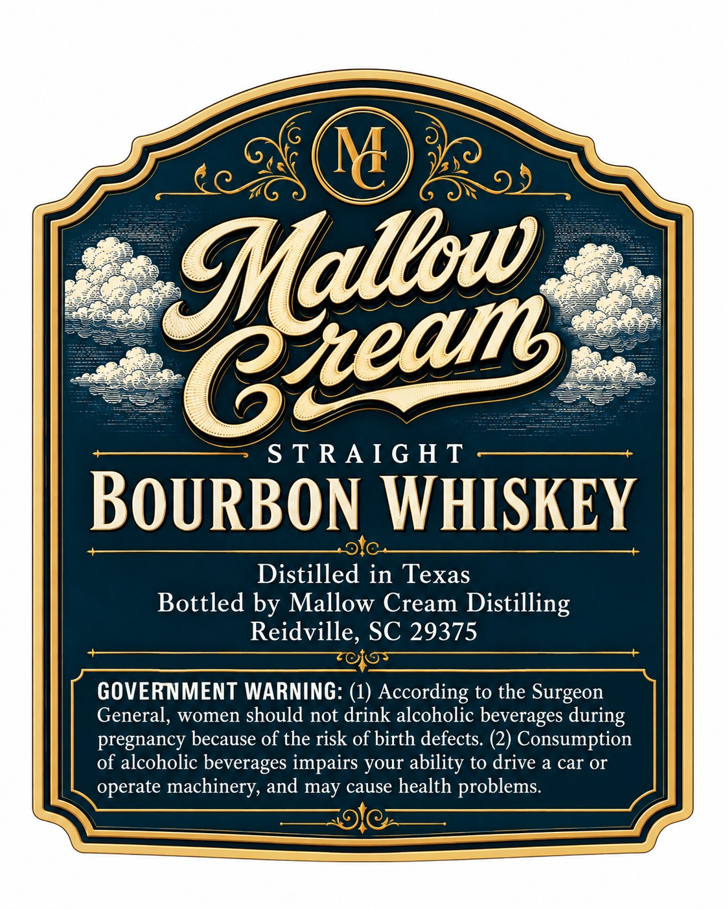
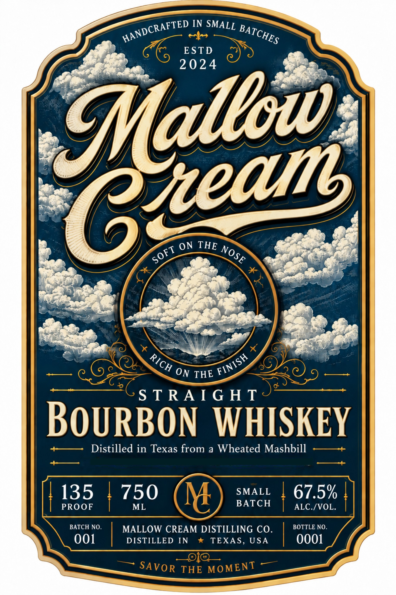

# TTB COLA Label Images - TTBID 26276001000034

**Brand Name:** MALLOW CREAM

**Issue Date:** 10/22/2026

**Origin Code:** 41

**Product Class/Type:** 101

**Source:** [TTB Public COLA Registry](https://ttbonline.gov/colasonline/viewColaDetails.do?action=publicFormDisplay&ttbid=26276001000034)

## Label Images

### Back Label

### Label 1

## Extracted Label Text

*Text extracted via OCR - may contain errors*

**Detected Proof:** 135

### Back Label

M
S TRA I G H T
BOURBON WHISKEY
Distilled in Texas
Bottled by Mallow Cream Distilling
Reidville, SC 29375
GOVERNMENT WARNING: (1) According to the Surgeon
General, women should not drink alcoholic beverages during
pregnancy because of the risk of birth defects: (2) Consumption
of alcoholic beverages impairs your ability to drive a car Or
operate machinery, and may cause health problems.
Gtatans

### Label 1

IN SMALL
ESTD
2 024
THE
"0
S TRA I G H T
BoURBON
WHISKEY
Distilled in Texas from
a Wheated Mashbill
135
750
M
SMALL
67.5%
PROOF
ML
BATCH
ALC /VOL.
BATCH NO.
MALLOW CREAM DISTILLING CO_
BOTTLE NO.
001
DISTILLED
IN
TEXAS, USA
0001
THE
HANDCRAFTED
BATCHES
Gtatkws
THE
ON
NOSE
SOFT
RICH
FINISH
ON
SAVoR
MOMENT
