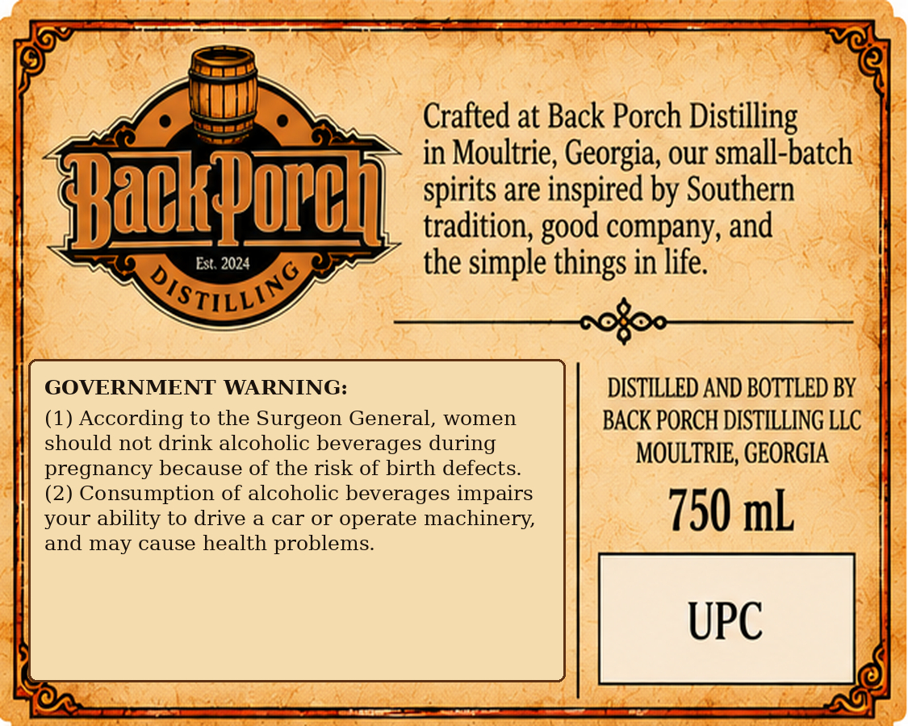
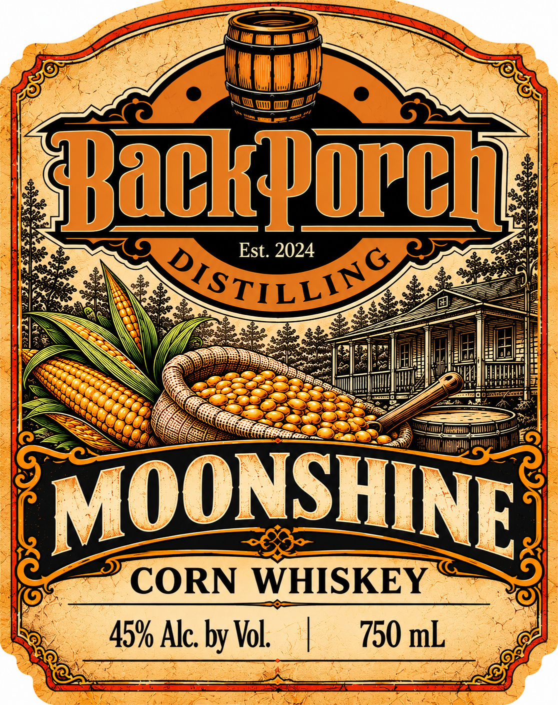
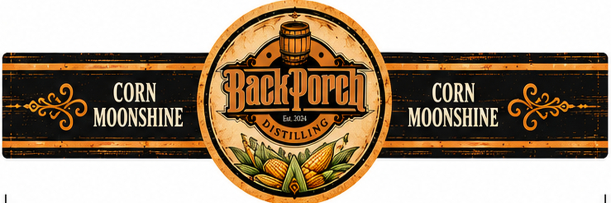

# TTB COLA Label Images - TTBID 26277001000072

**Brand Name:** BACK PORCH DISTILLING

**Fanciful Name:** MOONSHINE

**Issue Date:** 10/09/2026

**Origin Code:** 08

**Product Class/Type:** 143

**Source:** [TTB Public COLA Registry](https://ttbonline.gov/colasonline/viewColaDetails.do?action=publicFormDisplay&ttbid=26277001000072)

## Label Images

### Back Label

### Front Label

### Label 3

## Extracted Label Text

*Text extracted via OCR - may contain errors*

*1 image(s) excluded: text did not meet readability threshold*

### Back Label

Crafted at Back Porch Distilling
in Moultrie, Georgia, our small-batch
Hackpopch
spirits are inspired by Southern
tradition,
company, and
Est 2024
the simple things in life:
QSTILLIY
GOVERNMENT WARNING:
DISTILLED AND BOTTLED BY
(1) According to the Surgeon General,
women
BACK PORCH DISTILLING LLC
should not drink alcoholic beverages during
MOULTRIE, GEORGIA
pregnancy because of the risk of birth defects:
(2) Consumption of alcoholic beverages impairs
your ability to drive & car or operate machinery,
750 mL
and may cause health problems.
UPC
good

### Label 3

CORN
Backpopch
CORN
MOONSHINE
EuAA
MOONSHINE
QSTILLI9
