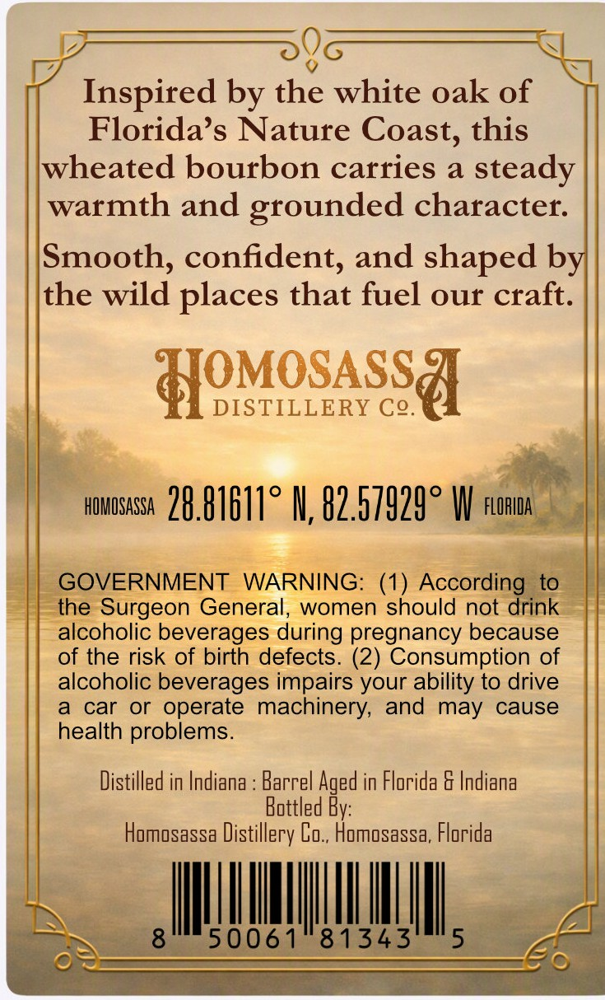
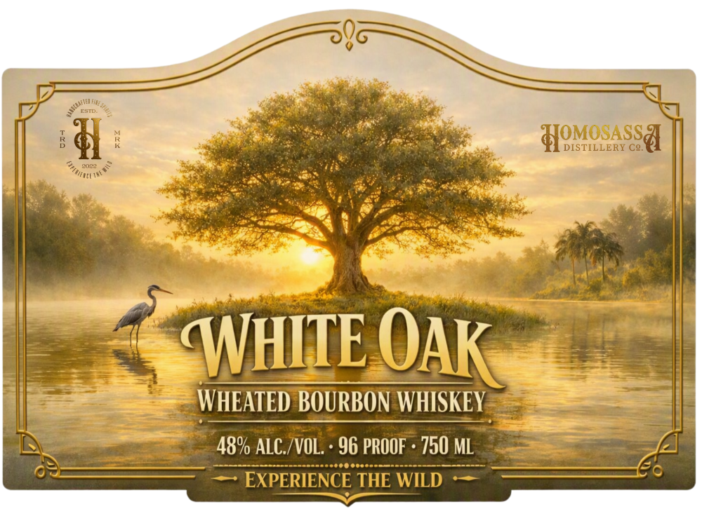
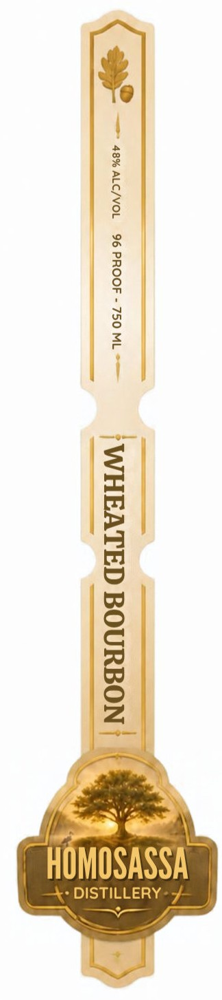

# TTB COLA Label Images - TTBID 26278001000068

**Brand Name:** WHITE OAK WHEATED BOURBON

**Issue Date:** 10/14/2026

**Origin Code:** 16

**Product Class/Type:** 141

**Source:** [TTB Public COLA Registry](https://ttbonline.gov/colasonline/viewColaDetails.do?action=publicFormDisplay&ttbid=26278001000068)

## Label Images

### Back Label

### Front Label

### Label 3

## Extracted Label Text

*Text extracted via OCR - may contain errors*

*1 image(s) excluded: text did not meet readability threshold*

**Detected Proof:** 96

### Back Label

D,

0)

QI

Inspired by the white oak of

Florida’s Nature Coast, this

wheated bourbon carries a steady

warmth and grounded character.

Smooth, confident, and shaped b

the wild places that fuel our craft

OMOSASS

DISTILLERY C2

=a

‘al

nowowssr 28. B1611° N, 82.57929° Wi

Fat

_ GOVER

——

NIN

41) Re

‘geon

eral,

men should not drink —

alcoholic beve

during pregnancy because

of the risk of birth defects. (2) Consumption of

alcoholic beverages impairs your ability to drive

a car or operate machinery, and may cause

health problems

Distilled in Indiana : Barrel Aged in Florida & Indiana

ottle

Homosassa Distillery Co., Homosassa, Florida

MII

### Front Label

ESTDE
HOsCass&
DISTILLERY Cg.
Inn
?onnow ?
WHITE
WHEATED BOURBON WHISKEY
48% ALC /VOL ' 96 PROOF + 750 ML
EXPERIENCE THE WILD
Jouinte ,
OAK
