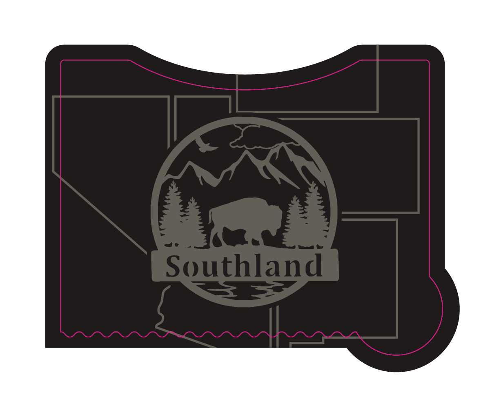
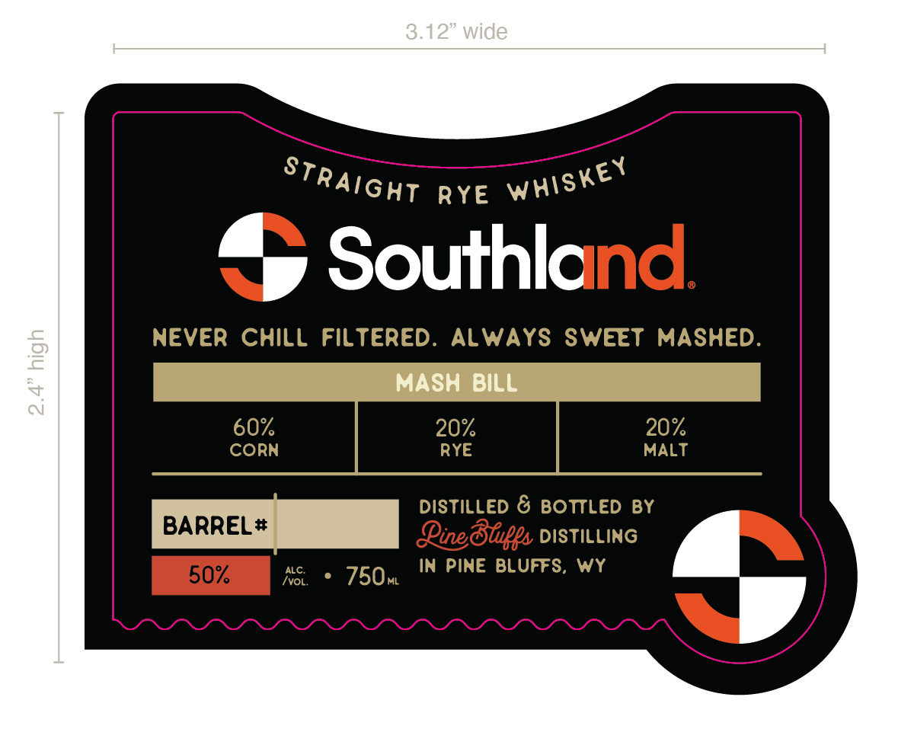

# TTB COLA Label Images - TTBID 26278001000080

**Brand Name:** PINE BLUFFS DISTILLING

**Fanciful Name:** SOUTHLAND

**Issue Date:** 10/13/2026

**Origin Code:** 49

**Product Class/Type:** 102

**Source:** [TTB Public COLA Registry](https://ttbonline.gov/colasonline/viewColaDetails.do?action=publicFormDisplay&ttbid=26278001000080)

## Label Images

### Back Label

### Front Label

### Label 4

## Extracted Label Text

*Text extracted via OCR - may contain errors*

*2 image(s) excluded: text did not meet readability threshold*

**Detected Proof:** 120

### Front Label

3.12" wide
R YE
Southland
NEVER Chill
FiLTERED .
ALWAYS SWEET
MASHED.
2
MASH BiLL
~
60%
20%
20%
CORN
RYE
MALT
DISTiLLED & BOTTLED BY
BARREL #
Qinedugs DISTILLING
ALC.
IN PinE BLUFFS, Wy
50%
750m
StRAight
Whiskey
Ivol;
