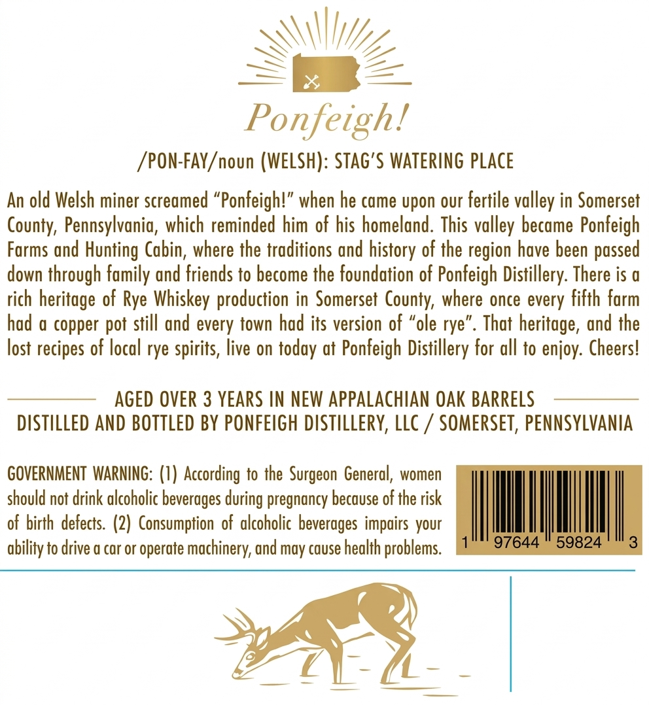
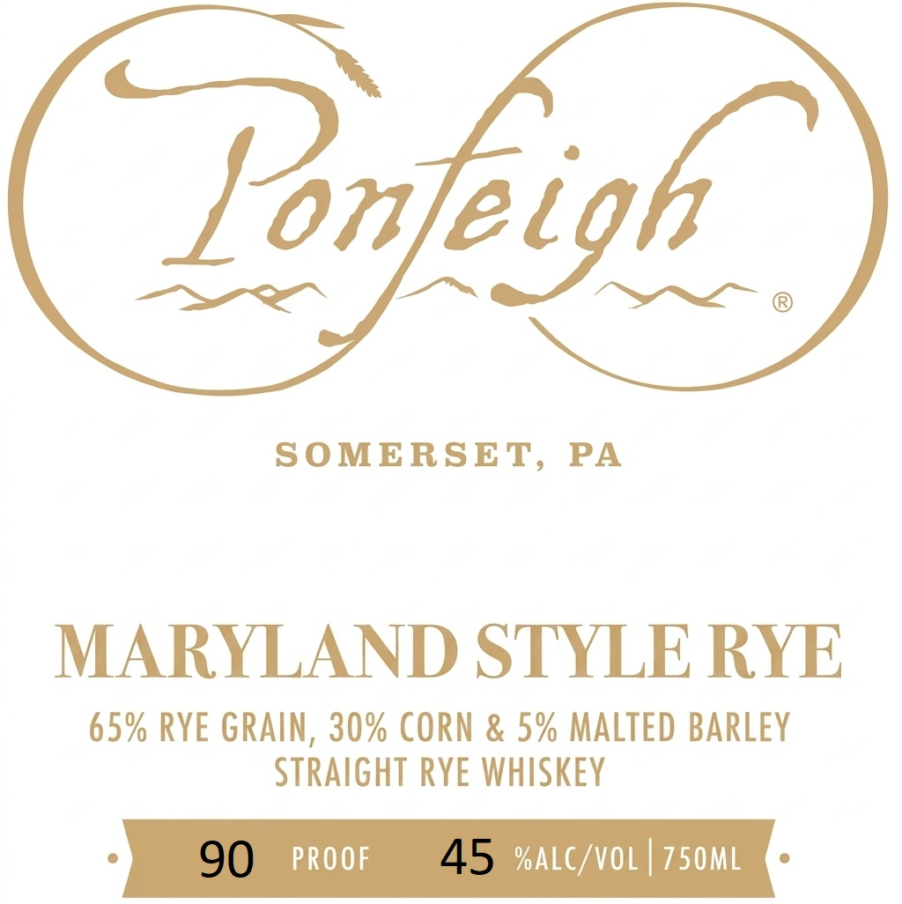

# TTB COLA Label Images - TTBID 26278001000176

**Brand Name:** PONFEIGH

**Fanciful Name:** MARYLAND RYE

**Issue Date:** 10/20/2026

**Origin Code:** 39

**Product Class/Type:** 102

**Source:** [TTB Public COLA Registry](https://ttbonline.gov/colasonline/viewColaDetails.do?action=publicFormDisplay&ttbid=26278001000176)

## Label Images

### Back Label

### Front Label

## Extracted Label Text

*Text extracted via OCR - may contain errors*

**Detected Proof:** 90
**Detected Age:** 3 Years

### Back Label

Ponfeigh!
/PON-FAY /noun (WELSH): Stag'$ WATERING place
An old Welsh miner screamed "Ponfeigh!" when he came upon our fertile valley in Somerset
County, Pennsylvania, which reminded him of his homeland. This
became Ponfeigh
Forms and Hunting Cabin, where the troditions and
of the region have been passed
down through
and friends to become the foundation of Ponfeigh Distillery: There is a
rich heritage of Rye Whiskey production in Somerset County, where once every fifth form
had a copper pot still and every town had its version of "ole rye'
That
and the
lost recipes of local rye spirits, live on today at Ponfeigh Distillery for all to enjoy: Cheers!
AGED OVER 3 YEARS IN NEW APPALACHIAN OAK BarRElS
DISTILLED AND BOTTLED BY PONFEIGH distilleRV, LLc
SomERSeT, PENNSYLVANIA
GOVERNMENT WARNING: (I) According to the
General, women
should not drink alcoholic beverages =
pregnancy because of the risk
of birth defects. (2) Consumption  of alcoholic beverages impairs your
ability to drive a cor or operate machinery; und may cause health problems
97644
59824
3
valley
history
fomily
heritage ,
Surgeon
during

### Front Label

Yonfeigh
SOMERSET,
PA
MARYLAND STYLE RYE
65% RYE GRAIN , 30% CORN & 5% MALTED BARLEY
STRAIGHT RYE WHISKEY
90
PROOF
45 %ALC/VOL
750ML
