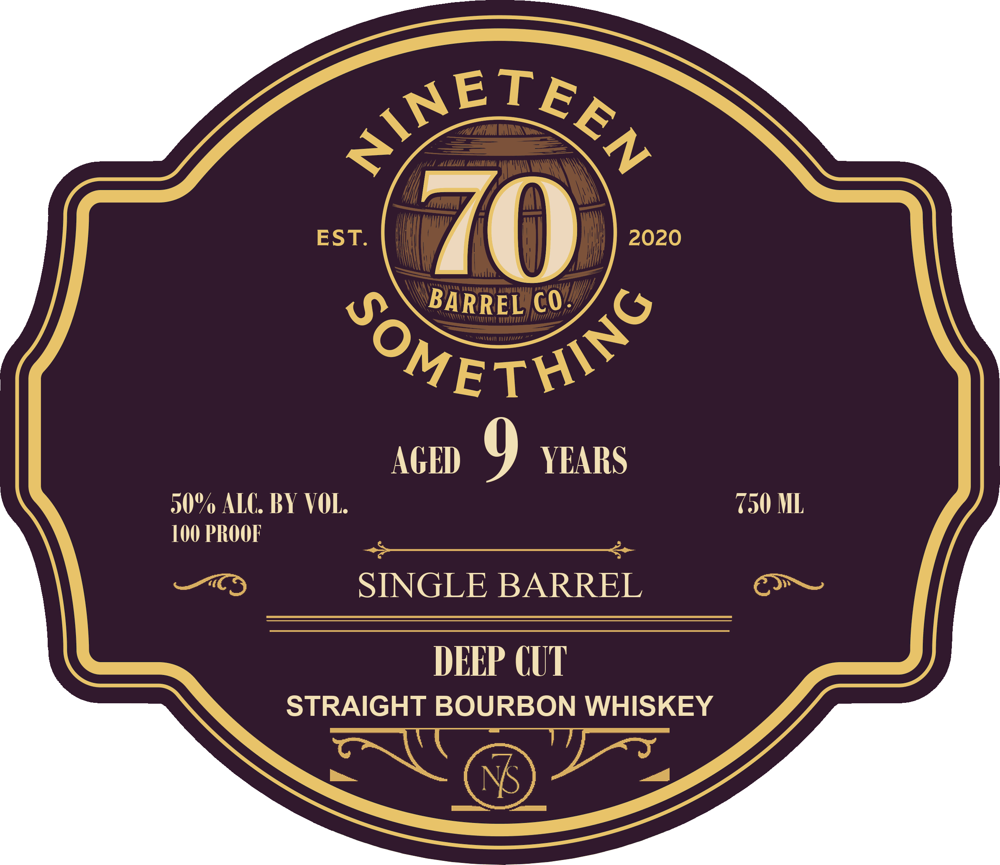
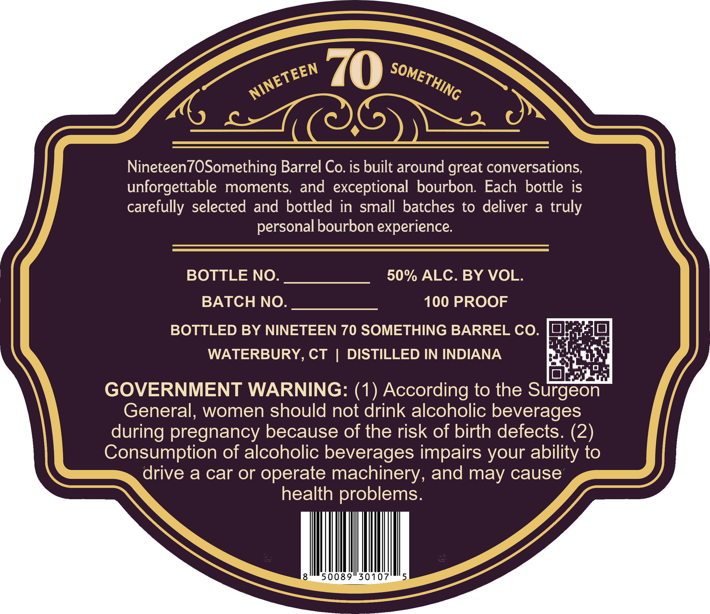

# TTB COLA Label Images - TTBID 26278001000263

**Brand Name:** NINETEEN70SOMETHING

**Fanciful Name:** DEEP CUT

**Issue Date:** 10/08/2026

**Origin Code:** 14

**Product Class/Type:** 101

**Source:** [TTB Public COLA Registry](https://ttbonline.gov/colasonline/viewColaDetails.do?action=publicFormDisplay&ttbid=26278001000263)

## Label Images

### Front Label

### Label 2

## Extracted Label Text

*Text extracted via OCR - may contain errors*

**Detected Proof:** 100
**Detected Age:** 9 Years

### Front Label

~ETEL
Camy
EST.
2020
BARREL CO
TitITITIIL

"OMETH/G
AGED
9
YEARS
50% ALC BY VOL:
750 ML
100 PROOF
SINGLE BARREL
DEEP CUT
STRAIGHT BOURBON WHISKEY
NS
dellaraitaa

### Label 2

7
Nineteen7OSomething Barrel Co. is built around great conversations,
unforgettable
moments, and exceptional bourbon   Each bottle is
carefully selected and bottled in small batches to deliver
a
truly
personal bourbon experience
BOTTLE NO.
50% ALC. BY VOL.
BATCH NO.
100 PROOF
BOTTLED BY NINETEEN 70 SOMETHING BARREL CO.
WATERBURY
CT
DISTILLED IN INDIANA
GOVERNMENT WARNING: (1) According to the Surgeon
General, women should not drink alcoholic beverages
during pregnancy because of the risk of birth defects. (2)
Consumption of alcoholic beverages impairs your ability to
drive a car or
operate machinery, and may cause
health problems.
8
50089
30107
5
SOMETHING
NINETEEN
