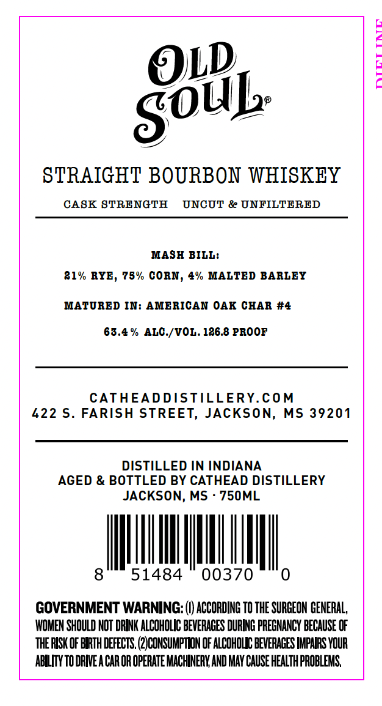
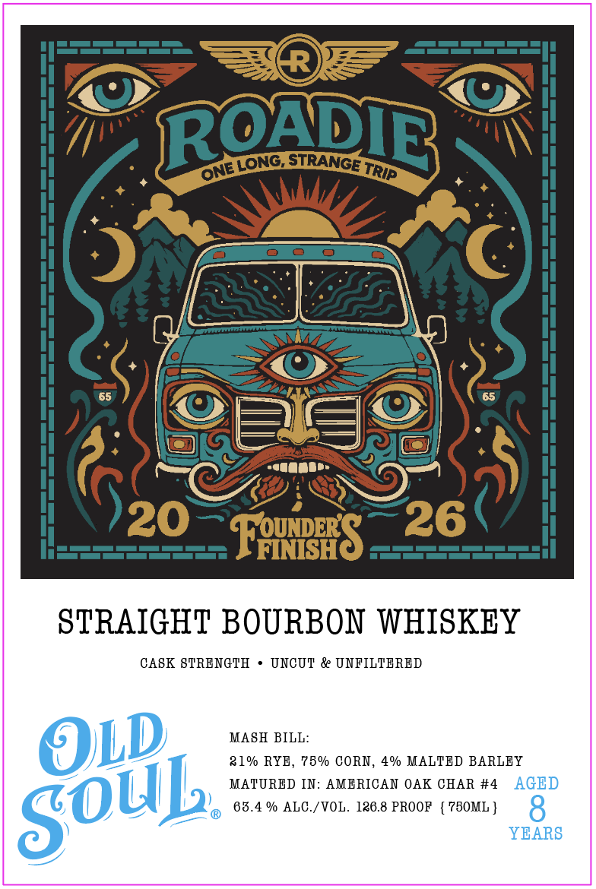

# TTB COLA Label Images - TTBID 26278001000427

**Brand Name:** OLD SOUL

**Issue Date:** 10/09/2026

**Origin Code:** 28

**Product Class/Type:** 101

**Source:** [TTB Public COLA Registry](https://ttbonline.gov/colasonline/viewColaDetails.do?action=publicFormDisplay&ttbid=26278001000427)

## Label Images

### Back Label

### Front Label

## Extracted Label Text

*Text extracted via OCR - may contain errors*

**Detected Proof:** 126.8
**Detected Age:** 8 Years

### Back Label

O1_
STRAIGHT BOURBON WHISKEY
CASK STRENGTH
UNCUT & UNFILTERED
MASH BILL:
81% RYE, 78% CORN ,
% MALTED BARLEY
MATURBD IN: AMBRICAN OAK CHAR #4
63.4 % ALC /VOL. 186.8 PROOF
CATHEADDISTILLERY.COM
L22 5_
FARISH STREET, JACKSON, MS 39201
DISTILLED IN INDIANA
AGED & BOTTLED BY CATHEAD DISTILLERY
JACKSON; MS
750ML
8
51484
00370
GOVERNMENT WARNING: (V) ACCORDING TO THE SURGEON GENERAL,
WOMEN SHOULD NOT DRINK ALCOHOLIC BEVERAGES DURING PREGNANCY BECAUSE OF
THE RISK OF BIRTH DEFECTS, (2JCOMSUMPTLON OF ALCOHOLIC BEVERAGES IMPNRS YOUR
AbILITY TO DRIE A CAR OR OPERATE MACHINERY AND May CAUSE HEALTH PROBLEMS
SOUL

### Front Label

RRODIB
FAtBrS
STRAIGHT BOURBON WHISKEY
CASK 8TRENGTH
UNCTT' & UNFILTBRED
OLD
MASH BILL:
21% RYE, 78% CORN , 4% MALTED BARLBY
MATURED IN: AMBRICAN OAK CHAR #4
AGED
65.4 % ALC /VOL
126.8 PROOF
7B0ML }
8
YEARS
LONG
STRANGE
ONE
TrIp
SOUL
