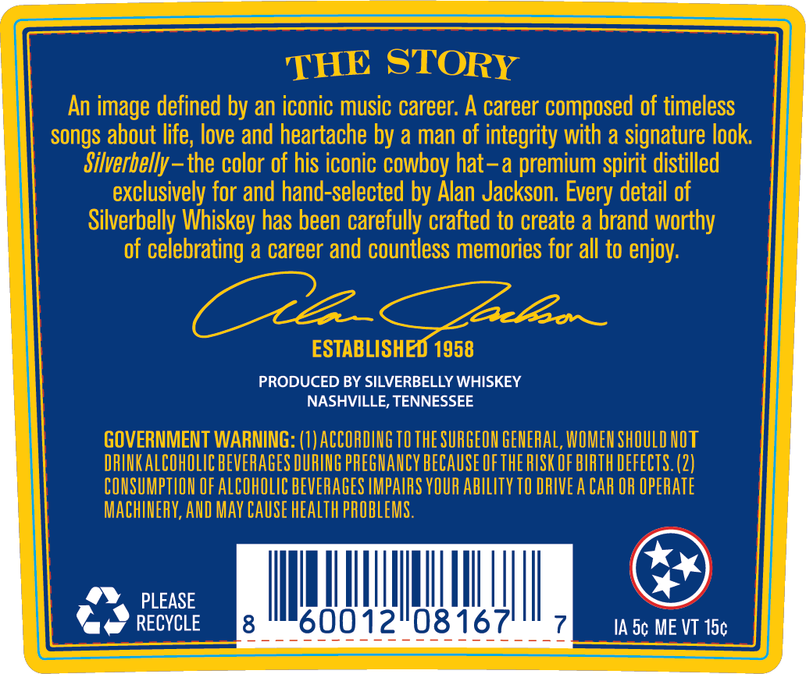
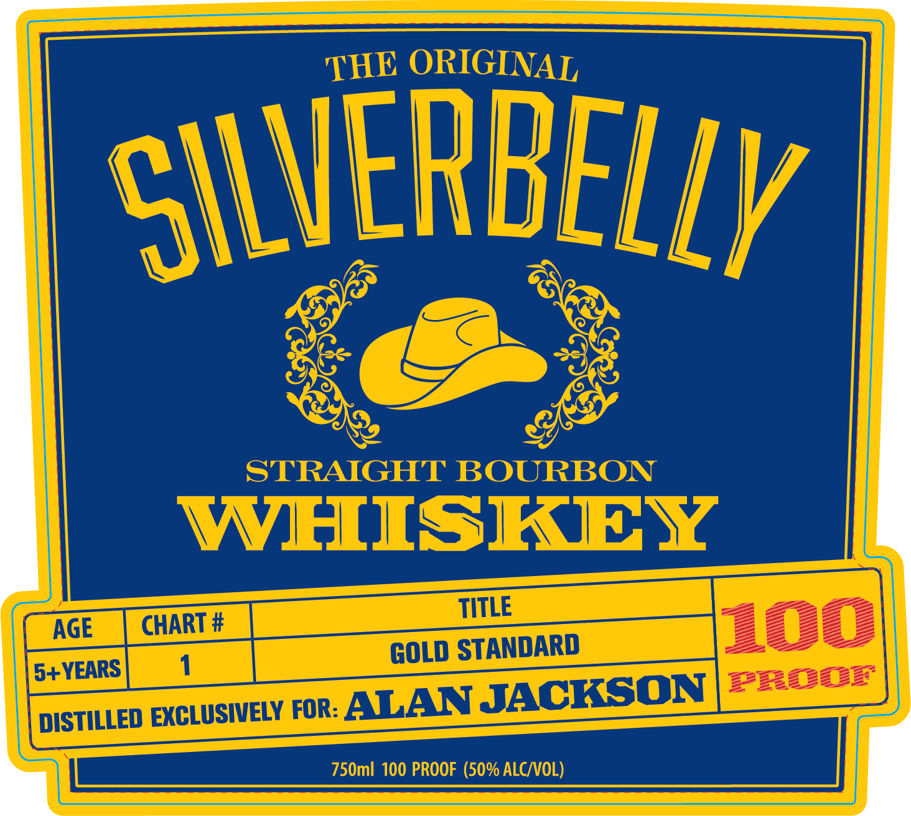
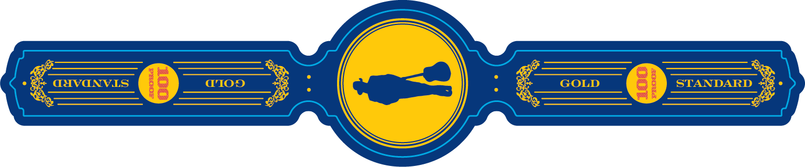

# TTB COLA Label Images - TTBID 26278001000439

**Brand Name:** SILVERBELLY WHISKEY

**Issue Date:** 10/09/2026

**Origin Code:** 43

**Product Class/Type:** 101

**Source:** [TTB Public COLA Registry](https://ttbonline.gov/colasonline/viewColaDetails.do?action=publicFormDisplay&ttbid=26278001000439)

## Label Images

### Back Label

### Front Label

### Label 3

## Extracted Label Text

*Text extracted via OCR - may contain errors*

*1 image(s) excluded: text did not meet readability threshold*

**Detected Proof:** 100

### Back Label

THE STORY
An image defined by an iconic music career: A career composed of timeless
songs about life; love and heartache by a man of integrity with a signature look
Silverbelly-
the color of his iconic cowboy hat -a premium spirit distilled
exclusively for and hand-selected by Alan Jackson. Every detail of
Silverbelly Whiskey has been carefully crafted to create a brand worthy
of celebrating a career and countless memories for all to enjoy:
ALa
Zlbov _
ESTABLISHEO 1958
PRODUCED BY SILVERBELLY WHISKEY
NASHVILLE, TENNESSEE
GOVERNMENT WARNING: (1) ACCORDING TO THE SURGEON GENERAL, WOMEN ShOULD NOT
DRINKALCOHOLIC BEVERAGES DURING PREGHANCY BECAUSE Ofthe RISK OF BIRTH DEFECTS. (2)
CONSUMPTLON OF ALcOhOLIc BEVERAGES IMPAIRS YOUR abILITy TO DRIVE A CAR OR OPERATe
MAChINERY,AND MaY CAuse heaLth PROBLEMS .
PLEASE
RECYCLE
8
600
21081671
(
IA Sc ME VT 15c

### Front Label

ORIGINAL
SILVERBELlY
STRAIGHT BOURBON
WHISKEY
TITLE
AGE
CHART #
100
GOLD STANDARD
5+YEARS
PHDDB
DISTILLED EXCLUSIVELY FoR ALAN JACKSQN
750ml 100 PROOF (50% ALC VOL)
THE
