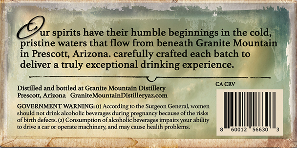
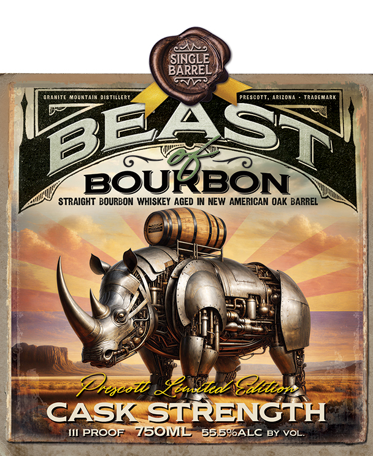

# TTB COLA Label Images - TTBID 26278001000492

**Brand Name:** GRANITE MOUNTAIN

**Fanciful Name:** BEAST OF BOURBON

**Issue Date:** 10/09/2026

**Origin Code:** 11

**Product Class/Type:** 101

**Source:** [TTB Public COLA Registry](https://ttbonline.gov/colasonline/viewColaDetails.do?action=publicFormDisplay&ttbid=26278001000492)

## Label Images

### Back Label

### Front Label

## Extracted Label Text

*Text extracted via OCR - may contain errors*

**Detected Proof:** 146

### Back Label

ur
spirits have their humble beginnings in the cold,
pristine waters that flow from beneath Granite Mountain
in Prescott; Arizona: carefully crafted each batch to
deliver a truly
exceptional drinking experience:
CA CRV
Distilled and bottled at Granite Mountain Distillery
Prescott; Arizona
GraniteMountainDistilleryazcom
GOVERNMENT WARNING: (1) According '
Surgeon
cneritomcn
should
drink alcoholic beverages
pregnancy
because ofthe risks
of birth defects: (2) Consumption of
Fadotoiecegeancy hapaise
YOuI
ability
drive
caror operate
machinery; and
Cauce
health problems:
60012
56630

### Front Label

SINGLE
BARREL
orrmite Moumtaim distillert
Fprescott,
Arizoma
Teademmel
BEAST
BOURBON
STRAIGHT BOURBON WHISKEY AGED IN NEW AMERICAN OAK BARREL
Pheseor _usizkat Sillore
CASK STRENGTH
IlI PROOF
73OML
55.5PALC BY VOL.
