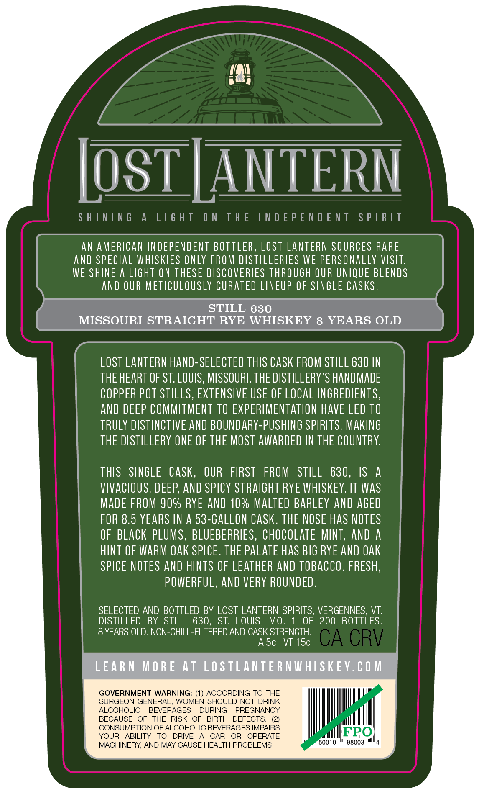
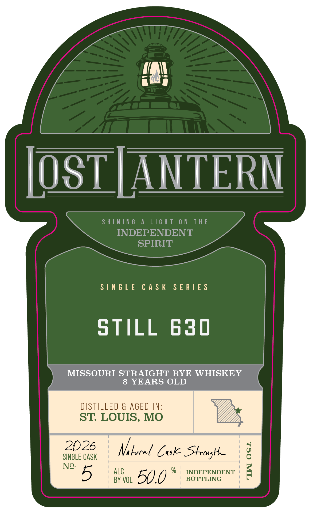

# TTB COLA Label Images - TTBID 26278001000515

**Brand Name:** LOST LANTERN

**Issue Date:** 10/09/2026

**Origin Code:** 46

**Product Class/Type:** 102

**Source:** [TTB Public COLA Registry](https://ttbonline.gov/colasonline/viewColaDetails.do?action=publicFormDisplay&ttbid=26278001000515)

## Label Images

### Back Label

### Front Label

### Label 3

## Extracted Label Text

*Text extracted via OCR - may contain errors*

**Detected Age:** 8 Years

### Back Label

LosTLANTERN
S H |NIN 6
A
[16 H T
0 N
T H E
IN D E P E N D E N T
S P | R /T
AN AMERICAN INDEPENDENT BOTTLER , LOST LANTERN SOURCES RARE
ANd SPECLAL WHISKIES ONLY FROM DISTILLERTES WE PERSONALLY VISIT:
WE SHINE
A LIghT ON THESE DISCOVERIES THROUGH OUR UNIQUE BLENDS
aNd OUR Meticulously CURATED LNEUP OF SINGLE CaSks .
STILL 630
MISSOURI STRAIGHT RYE WHISKEY 8 YEARS OLD
LOST LANTERN hand-SELECTED THIS CaSK FROM STILL 630 IN
THE HEART OF ST. LOUIS, MISSOURL. THE DISTILLERY 'S HANDMADE
COPPER POT STILLS, EXTENSIVE USE OF LOCAL INGREDIENTS,
and DEEP COMMITMENT tO EXPERIMENTATION HAVE LED TO
tRuLY DISTINCTIVE AND BOUNDARY-PUSHING SPIRITS, MAKING
THE DISTILLERY ONE OF THE MOST AWARDED IN THE COUNTRY:
THIS
SINGLE
CaSk,
OUR   FIRST
FROM
STILL
630 ,
IS
A
VIVAcioUS, DEEP; And SPICY STRAIGHT RYE WHISKEY. IT WaS
MADE FROM 90% RYE AND 10% MALTEd BARLEY AND AGEd
FOR 8.5 YEARS IN A 53-GALLON CASK. THE NOSE HAS NOTES
OF BLAcK PLUMS , BLUEBERRIES, CHOCOLATE MINT, AND A
HINT OF WARM oak SPICE. THE PALATE haS BIG RYE AND OAK
SPICE NOTES AND HINTS OF LEATHER AND TOBAcco. FRESH,
POWERFUL, And VERY ROUNDED .
SELECTED AND BOTTLED BY LOST LANTERN SPIRITS, VERGENNES, VT:
DISTILLED
BY  STILL 630,
ST:
LOUIS ,
MO.
OF
200 BOTTLES.
8 YEARS OLD. NON-CHILL FILTERED AND CASK STRENGTH
IA 54
VT 154
CA CRV
LEARN
M O RE At LOSTLANTE RNWHISKEY.€0 M
GOVERNMENT WARNING: (1} ACCORDING TO THE
SURGEON GENERAL.
WOMEN SHOULD NOT DRINK
ALCOHOLIC
BEVERAGES
DURING
PREGNANCY
BECAUSE
OF
THE
RISK OF
BIRTH
DEFECTS_
CONSUMPTION OF ALCOHOLIC BEVERAGES IMPAIRS
YOUR
ABILITY
TO
DRIVE
CAR
OR
OPERATE
FPO
MACHINERY, AND MAY CAUSE HEALTH PROBLEMS_
50010
98003

### Front Label

OST |ANTERN

SHINING A LIGHT ON THE

INDEPENDENT

SPIRIT

SINGLE CASK SERIES

STILL 630

MISSOURI STRAIGHT RYE WHISKEY

8 YEARS OLD

DISTILLED & AGED IN:

ST. LOUIS, MO

B

2026

SINGLE CASK

Nelocel Case Strong

ALC

INDEPENDENT

5

BY VOL

50.0 *

BOTTLING

### Label 3

| SHINING A LIGHT ON THE INDEPENDENT SPIRIT @& ii V LididS LNJONAddONI JHL NO LHSIT V ONINIHS |
