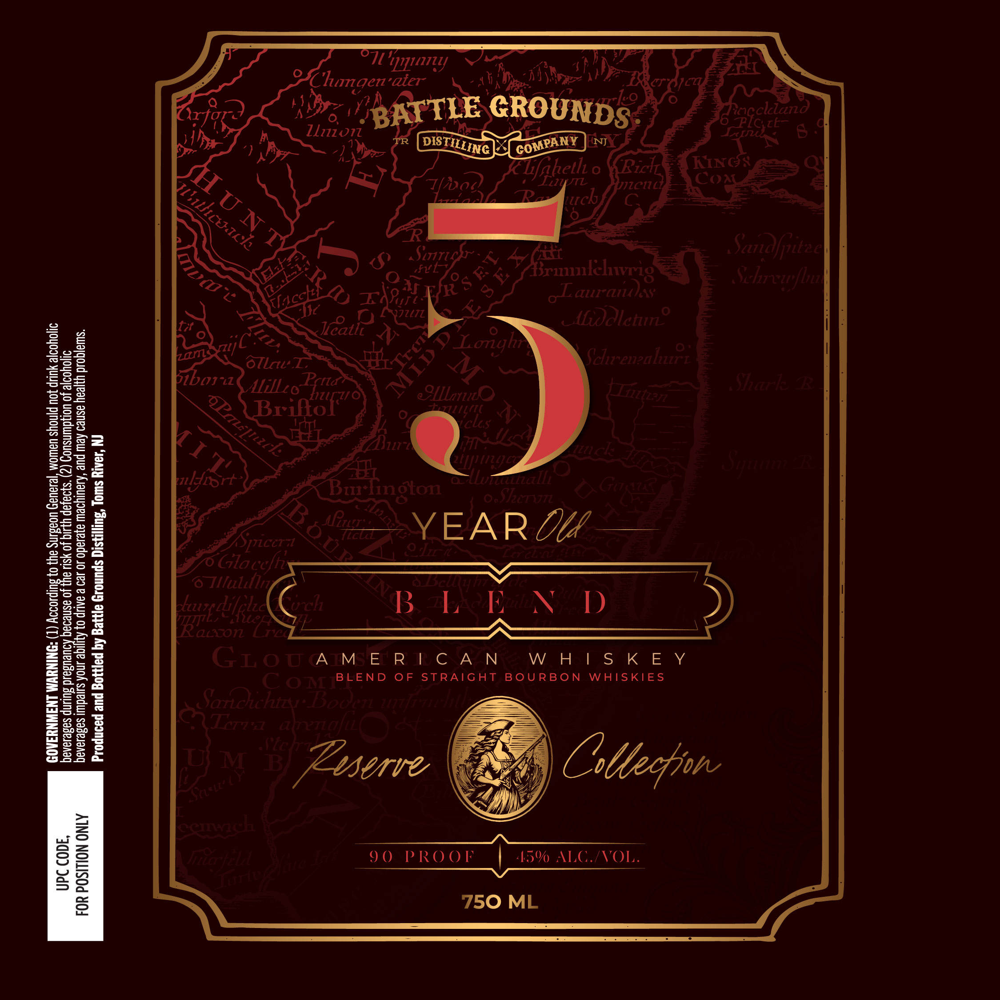

# TTB COLA Label Images - TTBID 26278001000581

**Brand Name:** BATTLE GROUNDS DISTILLING

**Issue Date:** 10/21/2026

**Origin Code:** 03

**Product Class/Type:** 121

**Source:** [TTB Public COLA Registry](https://ttbonline.gov/colasonline/viewColaDetails.do?action=publicFormDisplay&ttbid=26278001000581)

## Label Images

### Back Label

## Extracted Label Text

*Text extracted via OCR - may contain errors*

### Back Label

77
"pqiny
Chagen"aier
ko
GROUNDS
Reccland
ZL
Llnion
FtC
HNJ
Eaheth =
0
Ricl
KN:
Llu
JJCUL
CoA
7)
8
SuFio
Brmnlehwrig
Sandfjuitac
O
Iler
oLaurand)
aoa
Schrvwfbun
O
OJZLz
ALolcturc
Ir
Jcatli
1
0

9 Longl
2
oTlrl
^
ScenealcL
1
4
bbon
AilLzo
SiicriE
2
Eilor"
@OLILatO
L1Lci€
8
]
8
2
clas
1
2
KZi] Ga
7v
3
1
7,
2ELAte
5
9
lyibrt
Bur finoton
uzzutalll
Goaia
#
Shcrutl
#
Spccr 71
ABuoe
0 1
YEAR Dc
228
Glo
LerGln
8
28
1
[ule
EBellFz
3
52
9
onch
B H.eEl
I)
=
1
2
1
Ueasc

3
5
Ii
2
3
G1oo A BE E 8 STCAA+N
BLEND
0F
STRAIGHT
BOU RBON
WBAN WS SKIE Y
01
Sarochiau  Booen
Ih
KAErratta
U} M
FB
Zsserve
Cttefjon
3
{
Jilefizicl
Mte
9 0
P RO 01
45% ALG FVOL.
8
750 ML
BATTLE
DISTILLING
COMPANY
Hu NT
Tllhcuach
Etrch
8 E X
VR8s e€
TlacchL
6
zan
F3
Sll
APa[cl
M I [
TI1/2
#Siptittite
KLa L
3
Cefi
1
irit]ittta
atrenafti
Alltti[d
cemwach
