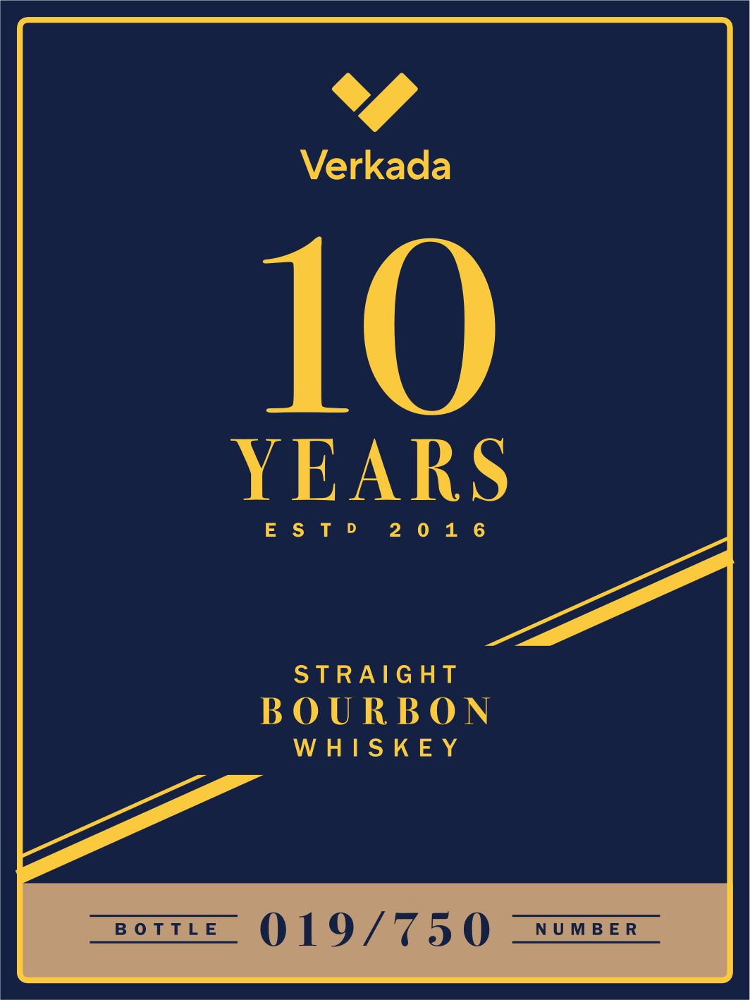
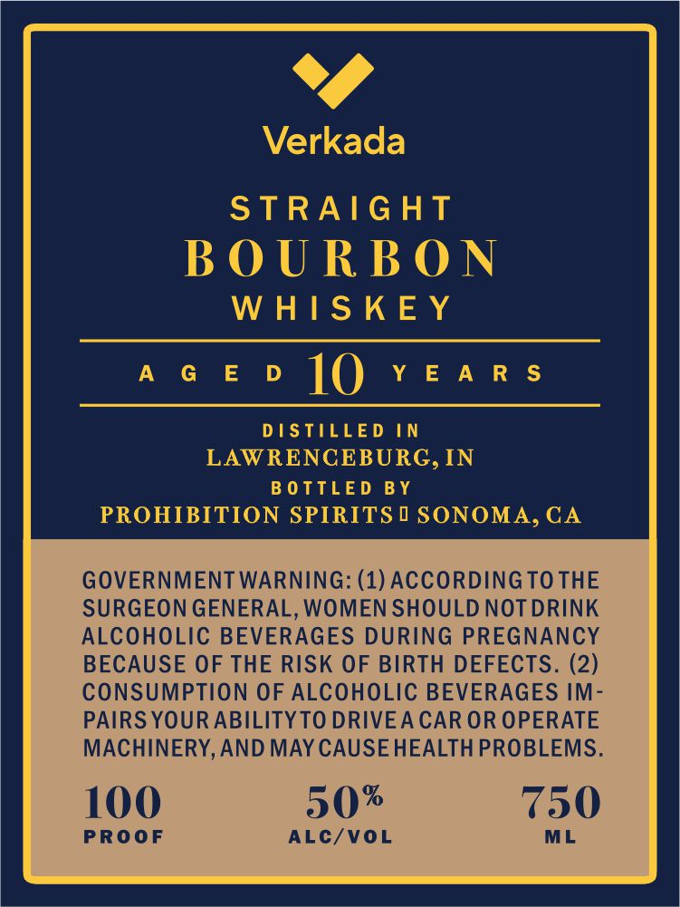

# TTB COLA Label Images - TTBID 26278001000599

**Brand Name:** VERKADA

**Issue Date:** 10/09/2026

**Origin Code:** 01

**Product Class/Type:** 101

**Source:** [TTB Public COLA Registry](https://ttbonline.gov/colasonline/viewColaDetails.do?action=publicFormDisplay&ttbid=26278001000599)

## Label Images

### Back Label

### Front Label

## Extracted Label Text

*Text extracted via OCR - may contain errors*

**Detected Age:** 10 Years

### Back Label

0

Verkada

10

YEARS

Enomii

2016

STRAIGHT

BOURBON

WHISKEY

BOTTLE

019/750

NUMBER

### Front Label

y)

Verkada

KaQGa

STRAIGHT

BOURBON

WHISK

acevo |[() Years

DISTILLED IN
LAWRENCEBURG, IN
- BOTTLED BY
PROHIBITION SPIRITS 1 SONOMA, CA

GOVERNMENT WARNING: (1) ACCORDING TO THE
SURGEON GENERAL, WOMEN SHOULD NOT DRINK
ALCOHOLIC BEVERAGES DURING PREGNANCY
BECAUSE OF THE RISK OF BIRTH DEFECTS. (2)
CONSUMPTION OF ALCOHOLIC BEVERAGES IM-

PAIRS YOUR ABILITY TO DRIVEA CAR OR OPERATE
MACHINERY, AND MAY CAUSEHEALTH PROBLEMS.

100 50* 750

PROOF ALC/VOL
