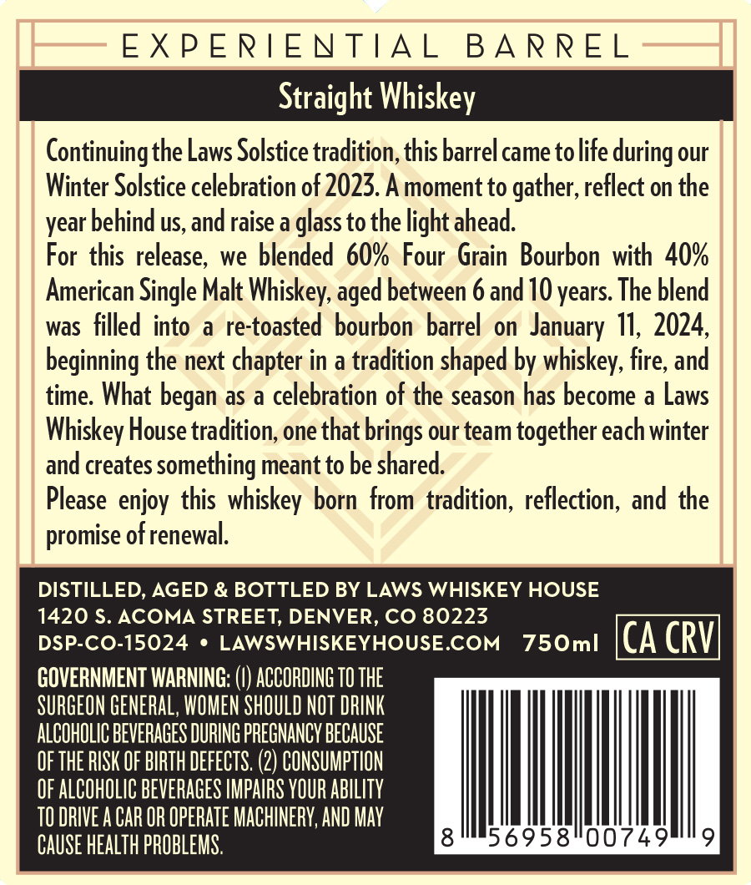
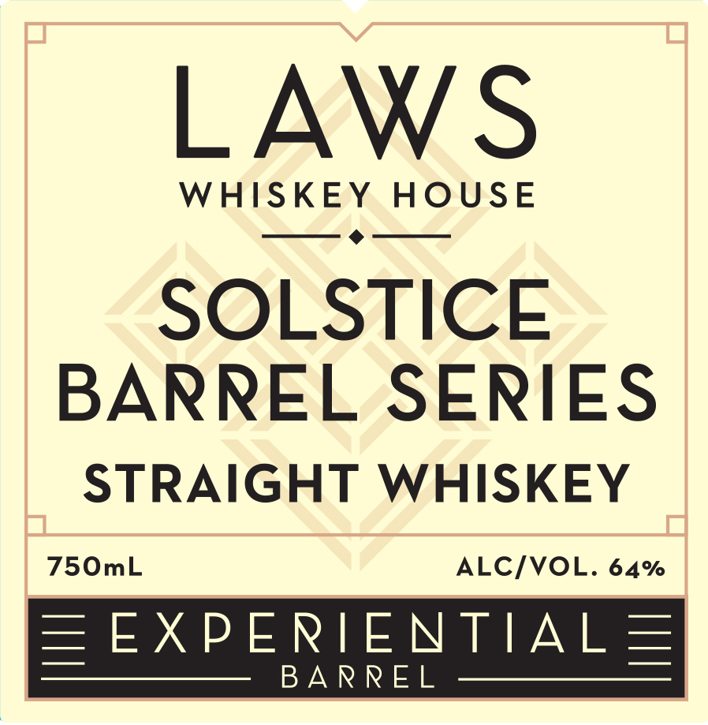
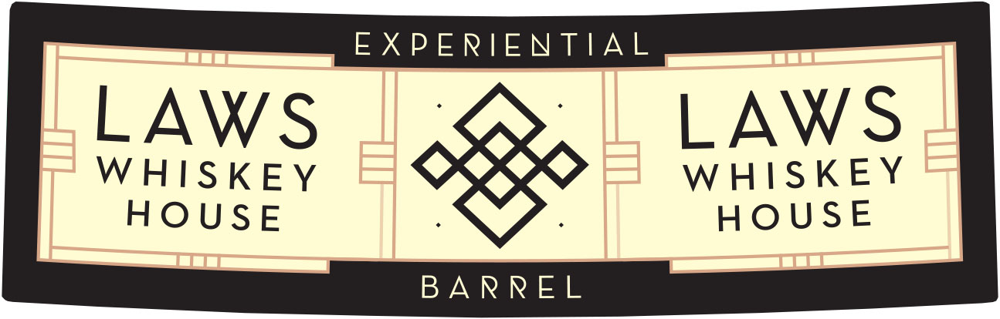

# TTB COLA Label Images - TTBID 26278001000600

**Brand Name:** LAWS WHISKEY HOUSE

**Fanciful Name:** SOLSTICE BARREL SERIES

**Issue Date:** 10/13/2026

**Origin Code:** 13

**Product Class/Type:** 109

**Source:** [TTB Public COLA Registry](https://ttbonline.gov/colasonline/viewColaDetails.do?action=publicFormDisplay&ttbid=26278001000600)

## Label Images

### Back Label

### Front Label

### Label 3

## Extracted Label Text

*Text extracted via OCR - may contain errors*

**Detected Age:** 10 Years

### Back Label

EXPERIENTIA L
B A RREL
Straight Whiskey
Continuingthe Laws Solstice tradition; this barrel came tolife during our
Winter Solstice celebration of 2023. A moment to gather, reflect on the
behind us, and raise a glass to the light ahead.
For this release, we blended 60% Four Grain Bourbon with   40%
American Single Malt Whiskey,
between 6 and 10 years The blend
was filled into
a
re-toasted bourbon barrel on January 11, 2024,
beginning the next chapter in a tradition shaped by whiskey; fire; and
time: What
as a celebration of the season has become a Laws
Whiskey House tradition; one that brings our team together each winter
and creates something meant to be shared
Please enjoy this whiskey born from tradition; reflection; and the
promise ofrenewal.
DISTILLED, AGED & BOTTLED BY LAWS WHISKEY HOUSE
1420 $. ACOMA STREET, DENVER, CO 80223
DSP-CO-15024
LAWSWHISKEYHOUSE.COM
750ml
CA CRVI
GOVERNMENT WARNING:
ACCORDING TO THE
SURGEON GENERAL, WOMEN SHOULD NOT DRINK
ALCOHOLIC BEVERAGES DURING PREGNANCY BECAUSE
OF ThE RISK OF BIRTH DEFECTS. (2) CONSUMPTION
OF ALCOHOLIC BEVERAGES IMPAIRS YOUR AbILITy
TO DRIVE A CAR OR OPERATe MACHINERY; AND May
CAUSE health PROBLEMS.
56958"00749
year L
aged
began

### Front Label

LAWS
WHISKEY
HOUsE
SOLSTICE
BARREL SERIES
STRAIGHT WHISKEY
750mL
ALCIVOL. 64%
EEXPERIENTIAL
B A RREL

### Label 3

EXPERIENTIAL

LAWS

LAWS

WHISKEY

WHISKEY

HOUSE

HOUSE

BARREL
