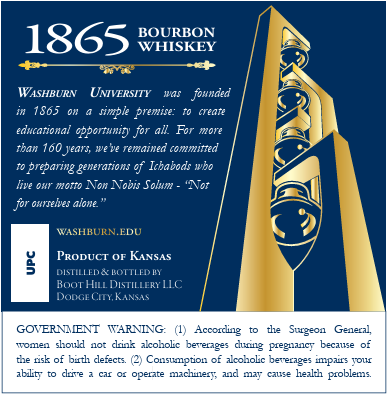
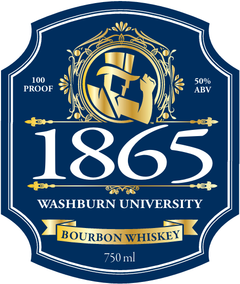

# TTB COLA Label Images - TTBID 26278001000611

**Brand Name:** 1865 WASHBURN BOURBON WHISKEY

**Issue Date:** 10/09/2026

**Origin Code:** 21

**Product Class/Type:** 141

**Source:** [TTB Public COLA Registry](https://ttbonline.gov/colasonline/viewColaDetails.do?action=publicFormDisplay&ttbid=26278001000611)

## Label Images

### Back Label

### Front Label

## Extracted Label Text

*Text extracted via OCR - may contain errors*

**Detected Proof:** 100

### Back Label

1865
BOUISKOY
97ecs
WASHBURN
UMVERSITY
was
founded
1805
Jimple premise: {0]Ereate
educational cpportunily for all For more
tban 160 Jears; we ve remained committed
preparing generations Gf Icbabod: wbo
live Ox1 mozto Non Nobis Solum
Nz
alone
WASHBURNEDU
PRoDucT 0r KANsAs
5
DfTLLDEICTTuDI
Root Hu DISTILLERY Ac
Inamcrnn
GOVERNMENT
TARNTNG:
Accorcing
Surgeon
Generil
Toem
soull
diis akcobolc bererages
Pregruc
Fecalse
the csk of bifth defects (2) Consumgtion of iroholc beverages ipairs yOUf
ablty
ckze
operate
michuler-
CWe
hezlh problems
Onnaes
dnng

### Front Label

100
50%
PROOF
ABV
1865
X
WASHBURN UNIVERSITY
BOURBON WHISKEY
750ml
